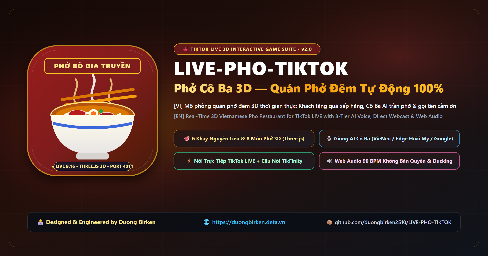

# 💿 Tải Bộ Cài Đặt Windows 1-Click (`.EXE`) — Dành Cho Người Dùng Không Rành GitHub / Node.js
## Download 1-Click Standalone Windows Installer (`Pho-Co-Ba-3D-Setup-v2.0.exe`)

<div align="center">
  
  <br /><br />
  <h3>
    👉 <a href="https://github.com/duongbirken2510/LIVE-PHO-TIKTOK/releases/latest/download/Pho-Co-Ba-3D-Setup-v2.0.exe"><b>[TẢI NGAY BỘ CÀI ĐẶT 1-CLICK: Pho-Co-Ba-3D-Setup-v2.0.exe]</b></a> 👈
  </h3>
  <p><i>(Đã tích hợp sẵn toàn bộ Node.js Runtime + Thư viện TikTok LIVE + Giọng đọc AI Cô Ba — Tải về bấm đúp là chạy ngay, KHÔNG cần cài đặt Node.js hay gõ lệnh!)</i></p>
</div>

---

## 🇻🇳 Hướng Dẫn Cài Đặt Trong 10 Giây (Dành Cho Người Không Rành Kỹ Thuật)

1. **Bước 1 — Tải file cài đặt `.exe` duy nhất:**
   - Bấm vào liên kết: **[`Pho-Co-Ba-3D-Setup-v2.0.exe`](https://github.com/duongbirken2510/LIVE-PHO-TIKTOK/releases/latest/download/Pho-Co-Ba-3D-Setup-v2.0.exe)** (hoặc vào mục **[Releases](https://github.com/duongbirken2510/LIVE-PHO-TIKTOK/releases/latest)** ở cột bên phải trang GitHub).
2. **Bước 2 — Nhấp đúp mở bộ cài đặt:**
   - Mở file `Pho-Co-Ba-3D-Setup-v2.0.exe` vừa tải về.
   - *(Nếu Windows hiện bảng xanh **Windows protected your PC / SmartScreen**: Bấm vào chữ **More info** (Thông tin thêm) ➔ bấm nút **Run anyway** (Vẫn chạy)).*
3. **Bước 3 — Bấm nút `🚀 CÀI ĐẶT NGAY (1-CLICK)`:**
   - Bộ cài đặt sẽ tự động giải nén, **tạo biểu tượng `Phở Cô Ba 3D - TikTok LIVE` ngoài màn hình Desktop** và tự động mở bảng điều khiển game ở địa chỉ `http://localhost:4011`!
4. **Bước 4 — Những lần mở sau:**
   - Bạn chỉ cần nhấp đúp vào biểu tượng **`Phở Cô Ba 3D - TikTok LIVE`** ngoài màn hình Desktop (hoặc chạy trực tiếp file **`Pho-Co-Ba-3D.exe`** trong thư mục dự án).

---

## 🇬🇧 1-Click Windows `.EXE` Installer Guide (No Git or Node.js Required)

1. **Download:** Click **[`Pho-Co-Ba-3D-Setup-v2.0.exe`](https://github.com/duongbirken2510/LIVE-PHO-TIKTOK/releases/latest/download/Pho-Co-Ba-3D-Setup-v2.0.exe)** from **[GitHub Releases](https://github.com/duongbirken2510/LIVE-PHO-TIKTOK/releases/latest)**.
2. **Run Installer:** Double-click `Pho-Co-Ba-3D-Setup-v2.0.exe` (if Windows SmartScreen prompts, click **More info** ➔ **Run anyway**) and click **`🚀 CÀI ĐẶT NGAY (1-CLICK)`**.
3. **Play & Stream:** The installer includes a self-contained Node.js runtime and all dependencies, creates a **`Phở Cô Ba 3D - TikTok LIVE`** shortcut on your Desktop, and launches the Admin Dashboard at `http://localhost:4011` automatically.

---

## 🛠️ Dành Cho Lập Trình Viên: Tự Đóng Mới Lại Bộ Cài `.EXE`
Khi bạn chỉnh sửa mã nguồn và muốn xuất lại file `Pho-Co-Ba-3D.exe` cùng bộ cài `dist/Pho-Co-Ba-3D-Setup-v2.0.exe`, chỉ cần nhấp đúp vào **`DONG-GOI-EXE.bat`** hoặc chạy:
```bash
node build-installer.mjs
```
