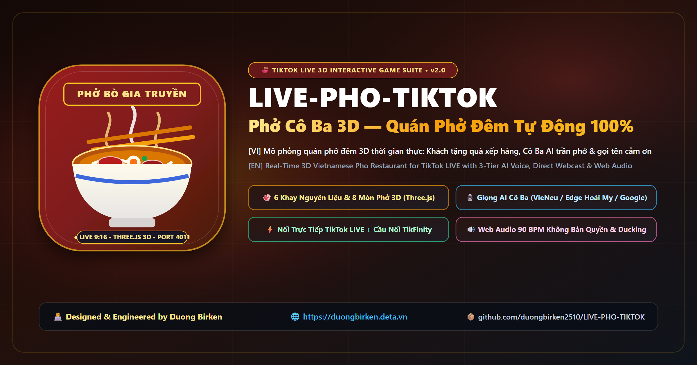
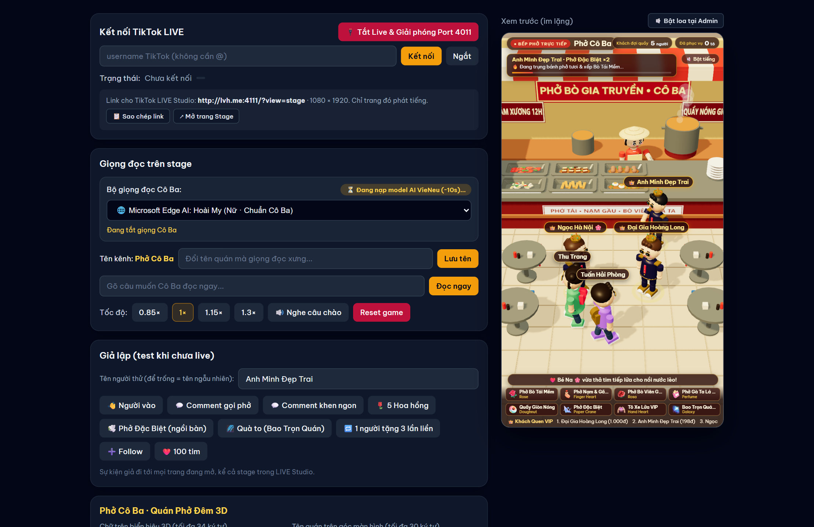
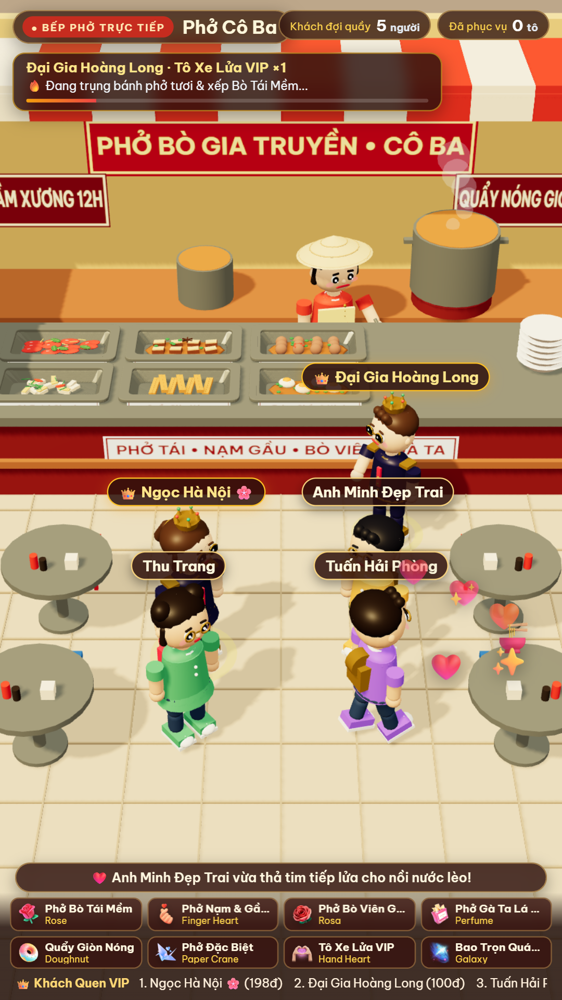
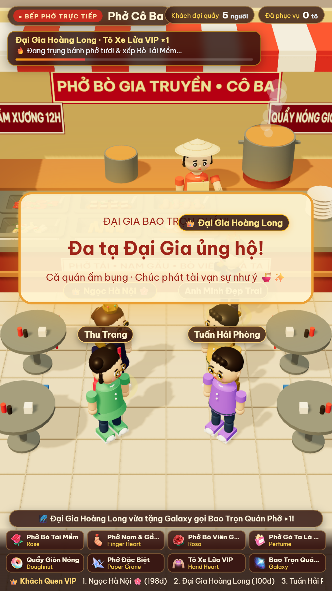
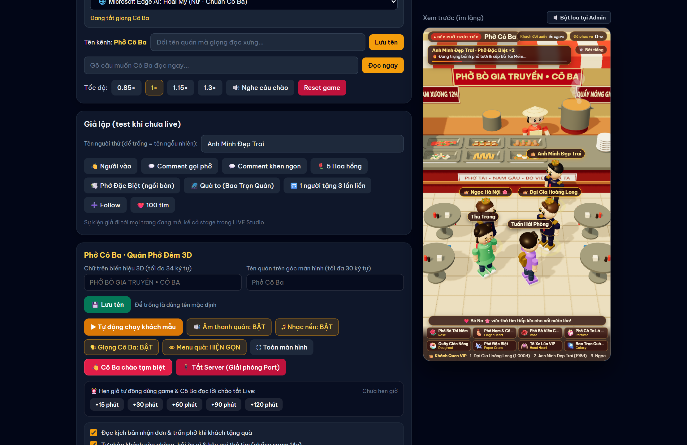
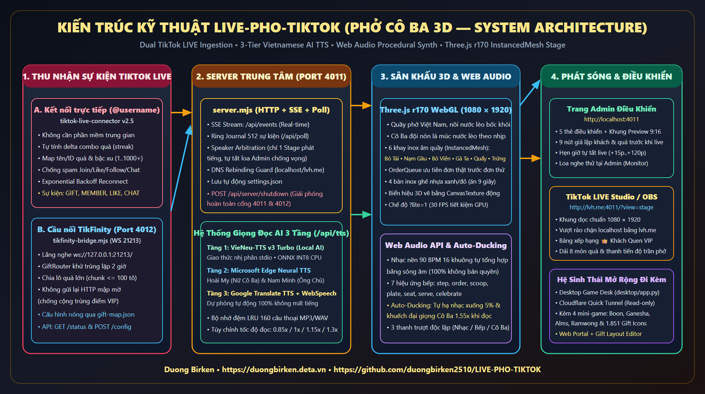

# 🍜 LIVE-PHO-TIKTOK — Phở Cô Ba 3D (Live-Pho v2.0)
## Game Mô Phỏng Quán Phở Đêm 3D Tương Tác Thời Gian Thực Cho TikTok LIVE · Real-Time 3D Vietnamese Night Pho Restaurant Interactive Game for TikTok LIVE

<div align="center">
  
  <br /><br />
  <p>
    <b>🇻🇳 Quán Phở Đêm 3D Tự Động 100% · Giọng Đọc AI Cô Ba 3 Tầng (VieNeu-TTS / Microsoft Edge Hoài My / Google) · 6 Khay Nguyên Liệu Inox &amp; 8 Món Phở Gắn Quà TikTok · Kết Nối Trực Tiếp `@username` &amp; TikFinity · Nhạc Nền 90 BPM Không Bản Quyền</b>
  </p>
  <p>
    <i>🇬🇧 100% Automated 3D Vietnamese Pho Stall for TikTok LIVE (`1080 × 1920`) · 3-Tier Vietnamese AI Voice Host · Three.js r170 InstancedMesh 3D Graphics · Procedural Web Audio Synthesizer &amp; Auto-Ducking · Direct Webcast &amp; TikFinity Bridge</i>
  </p>
  <p>
    🌐 <b>Website Tác giả / Author:</b> <a href="https://duongbirken.deta.vn"><b>Duong Birken — https://duongbirken.deta.vn</b></a>
    &nbsp;·&nbsp;
    💿 <b>Tải Bộ Cài Windows 1-Click (.EXE):</b> <a href="https://github.com/duongbirken2510/LIVE-PHO-TIKTOK/releases/latest/download/Pho-Co-Ba-3D-Setup-v2.0.exe"><b>Pho-Co-Ba-3D-Setup-v2.0.exe</b></a>
    &nbsp;·&nbsp;
    📖 <b>Hướng dẫn Sử dụng A–Z / User Guide:</b> <a href="docs/USER_GUIDE.md"><b>docs/USER_GUIDE.md</b></a>
    &nbsp;·&nbsp;
    📘 <b>Hồ sơ Công nghệ 10 Chương / Technical Whitepaper:</b> <a href="info/Introduce_LivePhoTikTok.md"><b>info/Introduce_LivePhoTikTok.md</b></a>
  </p>
</div>

---

## 📑 Mục Lục Nhanh / Table of Contents

- **🇻🇳 PHẦN TIẾNG VIỆT (VIETNAMESE DOCUMENTATION)**
  1. [Giới Thiệu Dự Án LIVE-PHO-TIKTOK (Phở Cô Ba 3D)](#-1-giới-thiệu-dự-án-live-pho-tiktok-phở-cô-ba-3d)
  2. [Hình Ảnh Giao Diện Thực Tế & Kiến Trúc Hệ Thống](#-2-hình-ảnh-giao-diện-thực-tế--kiến-trúc-hệ-thống)
  3. [Các Tính Năng Đột Phá Của Phở Cô Ba 3D (v2.0)](#-3-các-tính-năng-đột-phá-của-phở-cô-ba-3d-v20)
  4. [Bảng Thực Đơn 8 Món Phở Gắn Quà TikTok & Cơ Chế Khách Ngồi Bàn](#-4-bảng-thực-đơn-8-món-phở-gắn-quà-tiktok--cơ-chế-khách-ngồi-bàn)
  5. [Hướng Dẫn Cài Đặt & Phát Trực Tiếp 1-Click (`BAT-LIVE.bat`)](#-5-hướng-dẫn-cài-đặt--phát-trực-tiếp-1-click-bat-livebat)
  6. [Hệ Sinh Thái 5 Trò Chơi & Công Cụ Đi Kèm Trong Repo](#-6-hệ-sinh-thái-5-trò-chơi--công-cụ-đi-kèm-trong-repo)
  7. [Cấu Trúc Mã Nguồn & Kiểm Thử Tự Động](#-7-cấu-trúc-mã-nguồn--kiểm-thử-tự-động)
- **🇬🇧 ENGLISH DOCUMENTATION (DETAILED OVERVIEW & USER MANUAL)**
  1. [Project Overview — What is LIVE-PHO-TIKTOK?](#-1-project-overview--what-is-live-pho-tiktok)
  2. [Key Features & Technical Highlights](#-2-key-features--technical-highlights)
  3. [8 TikTok Gift-Bound Pho Dishes & Dining Mechanics](#-3-8-tiktok-gift-bound-pho-dishes--dining-mechanics)
  4. [Quick Start & TikTok LIVE Studio Setup Guide](#-4-quick-start--tiktok-live-studio-setup-guide)
  5. [Architecture, API Endpoints & Automated Testing](#-5-architecture-api-endpoints--automated-testing)
  6. [Author & Contact — Duong Birken](#-6-tác-giả--liên-hệ--author--contact)

---

# 🇻🇳 PHẦN TIẾNG VIỆT — MÔ TẢ CHI TIẾT & HƯỚNG DẪN SỬ DỤNG

## 🎯 1. Giới Thiệu Dự Án LIVE-PHO-TIKTOK (Phở Cô Ba 3D)

**LIVE-PHO-TIKTOK (`Phở Cô Ba 3D — Live-Pho v2.0`)** là nền tảng game mô phỏng **Quán Phở Đêm Việt Nam 3D** tương tác tự động 100% theo thời gian thực dành riêng cho **TikTok LIVE**, được thiết kế và nâng cấp toàn diện bởi **Duong Birken** ([https://duongbirken.deta.vn](https://duongbirken.deta.vn)) theo chuẩn giao diện điều khiển đồng nhất của hệ sinh thái `LIVE-TRANGNGUYEN`.

Trên khung hình dọc chuẩn **`1080 × 1920` (9:16)**, người xem bước vào không gian một quán phở đêm truyền thống ấm cúng:
- **Cô Ba đội nón lá** đứng sau quầy inox bên cạnh **nồi nước lèo hầm xương ống 12 tiếng nghi ngút khói** và **6 khay nguyên liệu inox âm quầy** (*Bò Tái Mềm, Nạm & Gầu Giòn, Bò Viên Gân, Gà Ta Lá Chanh, Quẩy Giòn Nóng, Trứng Chần & Hành*).
- Mỗi khi khán giả xem live **tặng quà TikTok**, một nhân vật 3D mang **tên của chính khán giả đó** sẽ bước vào xếp hàng trước quầy. Cô Ba lập tức xoay người múc nước lèo, trụng bánh phở tươi, xếp thịt bò tái/nạm gầu vào tô sứ viền xanh cổ truyền và **xướng tên khán giả bằng giọng đọc AI tiếng Việt đon đả** để cảm ơn.
- Đặc biệt, những vị khách gọi món combo từ 2 nguyên liệu trở lên (*Phở Đặc Biệt, Tô Xe Lửa VIP, Bao Trọn Quán Phở*) sau khi nhận tô phở bốc khói sẽ **bưng tô đi ra 4 chiếc bàn inox ghế nhựa xanh/đỏ ngồi xì xụp ăn phở trong 9 giây**, tạo nên khung cảnh quán phở đêm tấp nập, sống động suốt 24/7!

---

## 🖼️ 2. Hình Ảnh Giao Diện Thực Tế & Kiến Trúc Hệ Thống

### 2.1. Bảng Điều Khiển Admin 2 Cột & Khung Xem Trước 3D (`http://localhost:4011`)

<div align="center">
  
  <p><i>Giao diện Admin Dashboard tại <code>http://localhost:4011</code>: Cột trái gồm 5 thẻ điều khiển trực quan; cột phải là khung xem trước 3D 9:16 thời gian thực có công tắc <b>🔈 Bật loa tại Admin</b>.</i></p>
</div>

---

### 2.2. Màn Hình Sân Khấu Dọc Chuẩn TikTok LIVE Studio (`1080 × 1920` — `/?view=stage`) & Hiệu Ứng Đại Gia

| 🍜 Sân Khấu 9:16 Khi Cô Ba Trần Phở & Khách Ngồi Bàn | 🌌 Hiệu Ứng Vinh Danh Đại Gia Bao Trọn Quán (`Galaxy`) |
| :---: | :---: |
|  |  |
| **Cô Ba đội nón lá** múc nước lèo sau 6 khay nguyên liệu, khách xếp hàng chờ tới lượt, khách VIP ngồi ăn tại **4 bàn inox ghế nhựa** và bảng **`👑 Khách Quen VIP`** | Khi khán giả tặng **Galaxy / Sư tử**, băng rôn vàng **`ĐẠI GIA BAO TRỌN QUÁN!`** bật sáng kèm chuông mừng và lời cảm ơn Đại Gia từ Cô Ba |

---

### 2.3. Khu Vực Điều Khiển Chuyên Sâu & Sơ Đồ Kiến Trúc Kỹ Thuật

<div align="center">
  
  <p><i>Tùy biến chữ trên biển hiệu 3D tức thì, bộ hẹn giờ tự động tắt Live (<code>+15p..+120p</code>), 3 thanh trượt âm lượng độc lập và 8 nút gọi thử món phở.</i></p>
</div>

<div align="center">
  
  <p><i>Kiến trúc 4 tầng của LIVE-PHO-TIKTOK: Kết nối kép TikTok LIVE ➔ Node.js Core Server (Port 4011) ➔ AI Voice 3 Tầng &amp; Web Audio ➔ Three.js r170 WebGL Stage.</i></p>
</div>

---

## 🌟 3. Các Tính Năng Đột Phá Của Phở Cô Ba 3D (v2.0)

### 🎙️ 3.1. Hệ Thống Giọng Đọc AI Cô Ba 3 Tầng (`VieNeu-TTS` + `Microsoft Edge Neural` + `Google TTS`)
- **Tầng 1 — `VieNeu-TTS v3 Turbo` (Local AI Worker):** Tự động nhận diện môi trường `VieNeu-TTS` (nếu có trên máy) qua giao thức nhị phân `stdio`, nạp tới 25 giọng AI tiếng Việt chạy mượt trên CPU (`onnx_int8`).
- **Tầng 2 — `Microsoft Edge Neural TTS` (Mặc định sẵn sàng 100% không cần cài Python):**
  - **`🌐 Microsoft Edge AI: Hoài My (Nữ · Chuẩn Cô Ba)`**: Giọng nữ truyền cảm, đon đả, tự động tinh chỉnh cao độ `+2%` đúng chất cô chủ quán phở đêm.
  - **`🌐 Microsoft Edge AI: Nam Minh (Nam · Ông Chủ)`**: Giọng nam ấm áp cho chủ kênh muốn đổi phong cách Ông Chủ đứng bếp.
- **Tầng 3 — `Google Tiếng Việt` & `Web Speech API`:** Dự phòng tự động kèm bộ nhớ đệm LRU (`160 câu thoại MP3/WAV`), đảm bảo quán phở **không bao giờ bị mất tiếng** giữa buổi live.
- **Kịch bản thoại tự động 4 tình huống:**
  1. **Nhận đơn & trụng phở (`ackOrder`):** Ngay khi khách tặng quà, Cô Ba xướng tên cảm ơn món quà và báo đang trụng bánh phở tươi, đập lát gừng nướng.
  2. **Bưng tô & chúc ngon miệng (`thank`):** Sau 4 giây nấu xong, Cô Ba mời khách ăn nóng và kêu gọi thả tim (riêng món *Bao Trọn Quán Phở* có lời chúc Đại Gia phát tài riêng biệt).
  3. **Đón khách mới, cảm ơn Thả tim / Follow / Bình luận (`social`):** Tự động chào người mới vào phòng, hỏi khách ăn phở tái hay nạm gầu (có bộ lọc chống spam `14 giây`).
  4. **Tự động rao hàng khi quán vắng (`idleCallout`):** Mỗi `40 giây` nếu hàng đợi đang trống, Cô Ba tự động cất tiếng rao nước lèo hầm xương 12 tiếng để giữ nhiệt phòng live.

### 🔊 3.2. Nhạc Nền 90 BPM Tự Tổng Hợp (`0% Bản Quyền`) & Tự Động Hạ Nhạc Khi Cô Ba Nói (`Auto-Ducking`)
- **100% Web Audio API Procedural Synthesis:** Toàn bộ bản nhạc nền 16 khuông nhịp `90 BPM` và **7 hiệu ứng âm thanh nhà bếp** (*tiếng bước chân khách, chuông nhận đơn, tiếng muôi múc nước lèo, tiếng đặt tô sứ, tiếng kéo ghế nhựa, tiếng bưng phở, nhạc mừng Đại Gia*) đều được tính toán trực tiếp từ sóng âm trong [`games/curry-shop-3d/game.js`](games/curry-shop-3d/game.js) — **tuyệt đối không dùng file nhạc MP3 bên ngoài nên không bao giờ bị TikTok đánh bản quyền**.
- **Auto-Ducking thông minh:** Ngay khi Cô Ba bắt đầu nói, hệ thống tự động hạ mượt nhạc nền xuống còn **`5%`** và tiếng bếp xuống **`14%`**, đồng thời khuếch đại giọng đọc Cô Ba lên **`1.55×`** để lời thoại luôn rõ ràng, nổi bật nhất.
- **Chống vọng tiếng thông minh (`Speaker Arbitration`):** Mặc định chỉ màn hình Stage (`http://lvh.me:4011/?view=stage`) phát tiếng. Nếu bạn bật **`🔈 Bật loa tại Admin`** để nghe thử mà mở thêm trang Stage trong TikTok LIVE Studio, tab Admin sẽ tự động tắt loa nghe thử ngay lập tức để không bao giờ bị đè 2 luồng tiếng.

### ⚡ 3.3. Kết Nối Kép TikTok LIVE & Hàng Đợi Ưu Tiên Khách Thật
- **Kết nối trực tiếp bằng `@username` (`tiktok-live-connector`):** Chỉ cần gõ username TikTok vào ô trên Dashboard và bấm **Kết nối** — không cần cài bất kỳ phần mềm trung gian nào. Hệ thống tự động tính số lượng quà combo (`streakCounts`) và tự kết nối lại theo cấp số nhân (`15s ➔ 30s ➔ 60s ➔ 120s`) nếu mạng chập chờn.
- **Tích hợp sẵn Cầu nối TikFinity (`Port 4012`):** Song song với kết nối trực tiếp, server luôn mở sẵn `tikfinity-bridge.mjs` lắng nghe `ws://127.0.0.1:21213/` dành cho các chủ kênh thích dùng TikFinity Desktop.
- **Đơn thật luôn được ưu tiên làm trước đơn khách mẫu (`OrderQueue`):** Khi bạn bật **`▶ Tự động chạy khách mẫu`** để quán luôn đông vui, ngay khoảnh khắc có khán giả thật tặng quà, đơn hàng của khán giả thật sẽ **tự động nhảy lên đầu hàng đợi** trước toàn bộ khách mẫu và được ghi danh vào bảng **`👑 Khách Quen VIP`**.

---

## 🍜 4. Bảng Thực Đơn 8 Món Phở Gắn Quà TikTok & Cơ Chế Khách Ngồi Bàn

Quán có **6 khay nguyên liệu inox âm quầy** kết hợp thành **8 món thực đơn** tương ứng với 8 món quà TikTok (hoặc tự động quy đổi theo mệnh giá xu của bất kỳ món quà nào khách tặng):

| STT | Món Phở Trên Quầy 3D | Thành Phần Nguyên Liệu 3D Trong Tô | Quà TikTok Mặc Định | Mức Xu Tự Động | Hình Thức Phục Vụ & Điểm VIP |
| :-: | :--- | :--- | :--- | :---: | :--- |
| **1** | **Phở Bò Tái Mềm** | Thịt bò thăn thái mỏng trần tái hồng, gừng nướng & hành hoa | 🌹 **Rose** (`Hoa hồng` / ID `5655`) | `1 – 4 xu` | Nhận tô mang đi · **`+1 điểm`** |
| **2** | **Phở Nạm & Gầu Giòn** | Nạm bò hầm mềm, gầu vàng giòn sần sật thơm hoa hồi | 🫰 **Finger Heart** (`Bắn tim` / ID `5487`) | `5 – 9 xu` | Nhận tô mang đi · **`+5 điểm`** |
| **3** | **Phở Bò Viên Gân** | Bò viên gân dai giòn ngập trong nước dùng xương ống | 🌷 **Rosa** (`Bông hồng` / ID `8913`) | `10 – 19 xu` | Nhận tô mang đi · **`+10 điểm`** |
| **4** | **Phở Gà Ta Lá Chanh** | Thịt gà ta xé phay da vàng giòn rắc lá chanh non thái chỉ | 🌶️ **Perfume** (`Nước hoa` / ID `5658`) | `20 – 29 xu` | Nhận tô mang đi · **`+20 điểm`** |
| **5** | **Quẩy Giòn Nóng** | Cặp quẩy nóng vàng ươm giòn rụm chấm ngập nước phở | 🍩 **Doughnut** (`Bánh vòng` / ID `5879`) | `30 – 49 xu` | Nhận tô mang đi · **`+30 điểm`** |
| **6** | **Phở Đặc Biệt** *(Combo 3)* | **Bò Tái Mềm + Nạm & Gầu Giòn + Bò Viên Gân** | 🕊️ **Paper Crane** (`Hạc giấy` / ID `5659`) | `50 – 99 xu` | 🪑 **Ra bàn inox ngồi ăn 9 giây** · **`+99 điểm`** |
| **7** | **Tô Xe Lửa VIP** *(Combo 3)* | **Bò Tái Mềm + Quẩy Giòn Nóng + Trứng Chần Lòng Đào** | 🫶 **Hand Heart** (`Tim đôi` / ID `6968`) | `100 – 499 xu` | 🪑 **Ra bàn inox ngồi ăn 9 giây** · **`+100 điểm`** |
| **8** | **Bao Trọn Quán Phở** *(Full 6)* | **Đầy đủ cả 6 khay nguyên liệu** + Băng rôn Đại Gia | 🌌 **Galaxy / Lion** (`Dải ngân hà` / `Sư tử`) | `>= 500 xu` | 🪑 **Ngồi bàn 9s + Pháo hiệu Đại Gia** · **`+1000 điểm`** |

---

## 🚀 5. Hướng Dẫn Cài Đặt & Phát Trực Tiếp 1-Click (`BAT-LIVE.bat`)

> 📖 **Xem Cẩm nang Hướng dẫn Sử dụng Toàn tập từ A–Z (kèm hình ảnh từng bước):** [**`docs/USER_GUIDE.md`**](docs/USER_GUIDE.md)

### Bước 1: Khởi chạy quán phở chỉ với 1 cú nhấp đúp (Hỗ trợ cả Bộ cài `.EXE` 1-Click & Mã nguồn)

- **Cách A — Dành cho người dùng không rành GitHub / Node.js (Khuyên dùng — Chỉ 1 file `.EXE` duy nhất):**
  1. Tải bộ cài đặt tự động: **[`Pho-Co-Ba-3D-Setup-v2.0.exe`](https://github.com/duongbirken2510/LIVE-PHO-TIKTOK/releases/latest/download/Pho-Co-Ba-3D-Setup-v2.0.exe)** *(đã nhúng sẵn Node.js Runtime và toàn bộ thư viện, không cần cài thêm bất cứ phần mềm nào)*.
  2. Mở file vừa tải về (nếu Windows SmartScreen hỏi thì bấm **More info** ➔ **Run anyway**) rồi bấm nút **`🚀 CÀI ĐẶT NGAY (1-CLICK)`**.
  3. Phần mềm tự tạo biểu tượng **`Phở Cô Ba 3D - TikTok LIVE`** ngoài màn hình Desktop và tự mở ngay cửa sổ điều khiển `http://localhost:4011`!

- **Cách B — Dành cho người tải mã nguồn từ GitHub:**
  1. Cài đặt **Node.js (bản 20 hoặc 22 LTS trở lên)** từ [https://nodejs.org](https://nodejs.org).
  2. Tải dự án về máy:
     ```bash
     git clone https://github.com/duongbirken2510/LIVE-PHO-TIKTOK.git
     cd LIVE-PHO-TIKTOK
     ```
  3. Nhấp đúp vào **`Pho-Co-Ba-3D.exe`** (chạy ẩn không hiện cửa sổ CMD đen) hoặc **`BAT-LIVE.bat`** (hoặc **`CHAY_QUAN_PHO_3D.bat`**) ở thư mục gốc.

### Bước 2: Đưa màn hình Quán Phở 3D lên TikTok LIVE Studio (`1080 × 1920`)
1. Trên trang Admin `http://localhost:4011`, bấm nút **`📋 Sao chép link`** để chép địa chỉ Stage:
   ```text
   http://lvh.me:4011/?view=stage
   ```
   *(Nếu máy tính cấu hình yếu hoặc muốn tiết kiệm GPU, dùng link: `http://lvh.me:4011/?view=stage&lite=1`)*
2. Mở **TikTok LIVE Studio**, chọn khung hình **Dọc (`9:16 — 1080 × 1920`)** ➔ bấm **Thêm nguồn (Add Source)** ➔ **Liên kết (Link / Browser Source)** ➔ dán `http://lvh.me:4011/?view=stage` với kích thước **`1080 × 1920`**.
3. Sau khi bấm **Phát trực tiếp (Go LIVE)** trên TikTok LIVE Studio, quay lại trang Admin `http://localhost:4011`, nhập `username` TikTok của bạn (không cần `@`) và bấm **`Kết nối`**.

### Bước 3: Tắt Live & Giải phóng hoàn toàn Port 4011 khi nghỉ
- **Cách 1 (Ngay trên Web):** Bấm nút màu đỏ **`🔌 Tắt Live & Giải phóng Port 4011`** ở góc trên cùng bên phải trang Admin.
- **Cách 2 (Bằng file `.bat`):** Nhấp đúp vào file **`TAT-LIVE.bat`** (hoặc **`DUNG_QUAN_PHO_3D.bat`**) để đóng sạch tiến trình Node.js và giải phóng hoàn toàn cổng `4011` / `4012`.

---

## 🎮 6. Hệ Sinh Thái 5 Trò Chơi & Công Cụ Đi Kèm Trong Repo

Ngoài trò chơi chủ lực **Phở Cô Ba 3D (`games/curry-shop-3d` — Port `4011`)**, kho mã nguồn `LIVE-PHO-TIKTOK` còn tích hợp trọn bộ hệ sinh thái 5 trò chơi tương tác TikTok LIVE, ứng dụng Desktop quản lý tập trung và thư viện 1.851 quà tặng TikTok:

| Thư mục | Tên Mô-đun / Trò Chơi | Cổng Web / Bridge | Mô tả chức năng |
| :--- | :--- | :---: | :--- |
| **[`games/curry-shop-3d`](games/curry-shop-3d)** | **🍜 Phở Cô Ba 3D (Quán Phở Đêm 3D v2.0)** | **`4011` / `4012`** | **Trò chơi chủ lực:** Quán phở đêm 3D Việt Nam, giọng AI Cô Ba 3 tầng, nối trực tiếp `@username` + TikFinity, hẹn giờ tắt live & 8 món phở. |
| [`games/boon-live`](games/boon-live) | 🏮 Boon Live (Lễ Chùa Dâng Hương) | `8765` / `8766` | Không gian lễ chùa đỏ-vàng truyền thống, khách tặng quà thắp hương, trồng cây bồ đề, rung chuông cầu phúc. |
| [`games/ganesha-live`](games/ganesha-live) | 🐘 Ganesha Live (Đền Thần Ganesha) | `8785` / `8786` | Đền thờ ngoài trời với 4 lớp nhân vật và hiệu ứng dâng hoa, đèn hoa đăng, pháo lễ hội. |
| [`games/alms-live`](games/alms-live) | 🌅 Alms Live (Cúng Dường Buổi Sáng) | `8795` / `8796` | Khung cảnh bình minh thanh tịnh, hiển thị tên người xem dâng phẩm vật và lời chúc an lành. |
| [`games/ramwong-live`](games/ramwong-live) | 💃 Ramwong Live (Vũ Điệu Lễ Hội) | `8805` / `8806` | Sân khấu âm nhạc lễ hội sôi động, người xem tặng quà để lên sân khấu nhảy múa và đổi bài nhạc. |
| [`desktop/`](desktop/README.md) | 🖥️ TikTok LIVE Game Desk | GUI App | Ứng dụng Windows điều phối các trò chơi, hỗ trợ tạo link Cloudflare Quick Tunnel đọc-only. |
| [`gift-library/`](gift-library/README.md) | 🎁 Thư Viện 1.851 Quà Tặng TikTok | Static Catalog | Kho dữ liệu 1.851 món quà và 1.833 icon quà TikTok chuẩn phục vụ tùy biến thanh quà tặng. |
| [`web/`](web/README.md) | 🌐 Web Portal & Gift Layout Editor | Cloudflare Pages | Giao diện web chỉnh sửa bố cục quà tặng, xem thử mini-live và xác thực Firebase Auth. |

---

## 🛠️ 7. Cấu Trúc Mã Nguồn & Kiểm Thử Tự Động

```text
LIVE-PHO-TIKTOK/
├── BAT-LIVE.bat                     # [1-Click] Khởi chạy Phở Cô Ba 3D (Port 4011) & tự mở Admin Dashboard
├── TAT-LIVE.bat                     # [1-Click] Tắt Server & giải phóng hoàn toàn Port 4011 / 4012
├── CHAY_QUAN_PHO_3D.bat             # Bí danh khởi chạy nhanh Quán Phở 3D
├── DUNG_QUAN_PHO_3D.bat             # Bí danh tắt nhanh Quán Phở 3D
├── settings.json                    # Lưu trữ tự động cài đặt kênh, biển hiệu 3D, giọng đọc & âm lượng
├── docs/
│   ├── USER_GUIDE.md                # Cẩm nang Hướng dẫn Sử dụng Toàn tập từ A-Z (Song ngữ VI / EN)
│   ├── media/                       # Brand Banner 2K (SVG/PNG) & Sơ đồ Kiến trúc Kỹ thuật
│   └── screenshots/                 # Ảnh chụp giao diện thực tế Dashboard & Sân khấu 3D 9:16
├── info/
│   └── Introduce_LivePhoTikTok.md   # Hồ sơ Giới thiệu Sản phẩm & Công nghệ Chuyên sâu 10 Chương
├── games/
│   ├── curry-shop-3d/               # [CORE] Phở Cô Ba 3D — Quán Phở Đêm Tương Tác TikTok LIVE
│   │   ├── server.mjs               # Backend HTTP + SSE + Poll + Direct TikTok Connector + 3-Tier TTS
│   │   ├── tikfinity-bridge.mjs     # Cầu nối WebSocket TikFinity (Port 4012) & GiftRouter 8 món
│   │   ├── index.html               # Giao diện Admin Dashboard 2 cột & Khung Stage 9:16
│   │   ├── style.css                # Giao diện Dark Glassmorphism đồng nhất chuẩn LIVE-TRANGNGUYEN
│   │   ├── game.js                  # Lõi đồ họa Three.js r170, OrderQueue, Web Audio 90 BPM & SellerVoice
│   │   ├── gift-map.json            # Cấu hình ánh xạ 8 món quà TikTok sang 8 món phở
│   │   └── *.test.mjs               # Bộ 4 file Unit Test kiểm thử tự động (11 test cases)
│   ├── boon-live/                   # Mini-game Lễ Chùa (Port 8765)
│   ├── ganesha-live/                # Mini-game Đền Ganesha (Port 8785)
│   ├── alms-live/                   # Mini-game Cúng Dường Bình Minh (Port 8795)
│   └── ramwong-live/                # Mini-game Vũ Điệu Lễ Hội (Port 8805)
├── desktop/                         # Ứng dụng quản lý Desktop & Cloudflare Gateway
├── gift-library/                    # Danh mục 1.851 quà tặng TikTok kèm ảnh icon
└── web/                             # Web Portal & Trình chỉnh sửa bố cục quà tặng
```

### Lệnh Kiểm Thử Tự Động Dành Cho Lập Trình Viên
```bash
# Chạy trọn bộ 11 Unit Tests của Phở Cô Ba 3D (Đồ họa 3D, Hàng đợi, Web Audio, Ducking, AI Voice & SSE)
cd games/curry-shop-3d
node --test game.test.mjs seller-voice.test.mjs audio.test.mjs audio-controls.test.mjs

# Chạy kiểm thử Web Portal & Auth ở thư mục gốc
npm run test:web
```

---

# 🇬🇧 ENGLISH DOCUMENTATION — PROJECT OVERVIEW & USER GUIDE

## 🌍 1. Project Overview — What is LIVE-PHO-TIKTOK?

**LIVE-PHO-TIKTOK (`Phở Cô Ba 3D — Live-Pho v2.0`)** is a real-time, 100% automated **3D Vietnamese Night Pho Restaurant** interactive livestream game engineered for **TikTok LIVE**, created and upgraded by **Duong Birken** ([https://duongbirken.deta.vn](https://duongbirken.deta.vn)).

Designed specifically for vertical **`1080 × 1920` (`9:16`)** livestreams in **TikTok LIVE Studio** or **OBS Studio**, the game transforms viewer gifts, likes, follows, and comments into live 3D culinary actions:
- **Authentic 3D Vietnamese Street-Food Scene (`Three.js r170`):** Features **Cô Ba** wearing a traditional Vietnamese conical hat (`nón lá`) behind a stainless-steel counter, a steaming 12-hour bone broth cauldron, **6 recessed stainless-steel ingredient trays** rendered with `THREE.InstancedMesh`, and **4 stainless-steel dining tables with red and blue plastic stools**.
- **Interactive Viewer Lifecycle:** When a viewer sends a TikTok gift, a 3D avatar bearing their nickname enters the queue, walks up to the counter, watches Cô Ba ladle steaming broth and assemble their specific Pho bowl over a 4-second cooking animation, and—for multi-ingredient combo dishes—carries their bowl to an open dining table to sit and eat for 9 seconds!
- **3-Tier Vietnamese AI Voice Host:** Cô Ba automatically greets new viewers, thanks supporters for likes and follows, announces cooking steps when gifts arrive, delivers special VIP tributes for grand gifts (`Galaxy` / `Lion`), and performs periodic idle call-to-actions every `40 seconds`.

---

## ✨ 2. Key Features & Technical Highlights

1. **Dual TikTok LIVE Ingestion Pipeline ([`server.mjs`](games/curry-shop-3d/server.mjs) & [`tikfinity-bridge.mjs`](games/curry-shop-3d/tikfinity-bridge.mjs)):**
   - **Direct `@username` Connection:** Built-in `tiktok-live-connector` lets streamers connect directly from the browser dashboard by entering their TikTok username—no third-party bridge required. Includes streak gift delta calculation, social event throttling, and exponential backoff auto-reconnect.
   - **TikFinity WebSocket Bridge (`Port 4012`):** Simultaneously listens on `ws://127.0.0.1:21213/` with a 2-hour deduplication window and batch chunking (`<= 100` bowls) for users who prefer TikFinity Desktop.
2. **3-Tier Vietnamese AI Voice Engine (`/api/tts` & `createSellerVoice`):**
   - **Tier 1:** Local **VieNeu-TTS v3 Turbo (`ONNX INT8`)** binary `stdio` worker supporting 25 expressive Vietnamese AI voices on standard CPUs.
   - **Tier 2:** **Microsoft Edge Neural TTS (`msedge-tts`)** featuring **`vi-VN-HoaiMyNeural`** (Female — Cô Ba) and **`vi-VN-NamMinhNeural`** (Male — Shop Owner).
   - **Tier 3:** **Google Vietnamese TTS & Browser Web Speech API** fallback with a 160-entry LRU audio buffer cache.
3. **100% Copyright-Safe Procedural Web Audio & Auto-Ducking (`createRestaurantAudio`):**
   - Synthesizes a 16-bar `90 BPM` stereo background music loop and **7 distinct kitchen sound effects** (`step`, `order`, `scoop`, `plate`, `seat`, `serve`, `celebrate`) mathematically via `AudioContext`—zero external MP3 copyright strikes.
   - **Smart Auto-Ducking & Voice Boost:** Automatically lowers background music to `5%` and kitchen SFX to `14%` while boosting voice volume by `1.55×` whenever Cô Ba speaks.
   - **Single-Speaker Arbitration (`stageSpeakers`):** Prevents double-audio echo by ensuring only the active LIVE Studio Stage (`/?view=stage`) outputs audio, automatically muting the Admin preview monitor when the stage opens.
4. **Unified 2-Column Admin Dashboard (`http://localhost:4011`):**
   - Live 3D signboard customization (`CanvasTexture` updates instantly without page reload), 9 one-click simulation buttons, a 3-channel independent volume mixer, an auto-shutdown countdown timer (`+15m` to `+120m`), and a 1-click **`🔌 Tắt Live & Giải phóng Port 4011`** button that cleanly terminates all processes and frees ports `4011` and `4012`.

---

## 🍲 3. 8 TikTok Gift-Bound Pho Dishes & Dining Mechanics

| # | Vietnamese Pho Dish | 3D Ingredients in Bowl | Default TikTok Gift | Auto Coin Tier | Dining Behavior & VIP Score |
| :-: | :--- | :--- | :--- | :---: | :--- |
| **1** | **Phở Bò Tái Mềm** *(Rare Beef Pho)* | Thinly sliced medium-rare beef, roasted ginger & scallions | 🌹 **Rose** (`5655`) | `1 – 4 coins` | Takeout at counter · **`+1 pt`** |
| **2** | **Phở Nạm & Gầu Giòn** *(Brisket & Crunchy Flank)* | Slow-braised beef brisket, golden crunchy flank & star anise | 🫰 **Finger Heart** (`5487`) | `5 – 9 coins` | Takeout at counter · **`+5 pts`** |
| **3** | **Phở Bò Viên Gân** *(Tendon Beef Meatball)* | Bouncy beef tendon meatballs in 12h marrow broth | 🌷 **Rosa** (`8913`) | `10 – 19 coins` | Takeout at counter · **`+10 pts`** |
| **4** | **Phở Gà Ta Lá Chanh** *(Free-Range Chicken Pho)* | Shredded golden-skin chicken with kaffir lime leaves | 🌶️ **Perfume** (`5658`) | `20 – 29 coins` | Takeout at counter · **`+20 pts`** |
| **5** | **Quẩy Giòn Nóng** *(Crispy Fried Dough Sticks)* | Golden crispy crullers dipped in rich pho broth | 🍩 **Doughnut** (`5879`) | `30 – 49 coins` | Takeout at counter · **`+30 pts`** |
| **6** | **Phở Đặc Biệt** *(Special Combo Pho)* | **Rare Beef + Brisket & Flank + Beef Meatballs** | 🕊️ **Paper Crane** (`5659`) | `50 – 99 coins` | 🪑 **Sits & eats at table (9s)** · **`+99 pts`** |
| **7** | **Tô Xe Lửa VIP** *(Locomotive XL VIP Bowl)* | **Rare Beef + Crispy Dough Sticks + Poached Egg** | 🫶 **Hand Heart** (`6968`) | `100 – 499 coins` | 🪑 **Sits & eats at table (9s)** · **`+100 pts`** |
| **8** | **Bao Trọn Quán Phở** *(Grand Pho Feast — All 6)* | **All 6 ingredient trays** + Golden VIP Celebration Banner | 🌌 **Galaxy / Lion** (`11046`) | `>= 500 coins` | 🪑 **Sits at table + VIP Fanfare** · **`+1000 pts`** |

---

## ⚡ 4. Quick Start & TikTok LIVE Studio Setup Guide

> 📖 **Full Step-by-Step Bilingual User Manual:** [**`docs/USER_GUIDE.md`**](docs/USER_GUIDE.md)

1. **Prerequisites:** Install **Node.js 20+ or 22+ LTS** ([https://nodejs.org](https://nodejs.org)) on Windows 10/11 (or macOS/Linux).
2. **1-Click Launch:**
   - Double-click **`BAT-LIVE.bat`** (or **`CHAY_QUAN_PHO_3D.bat`**) at the repository root.
   - Dependencies install automatically on first run, the server starts on **Port `4011`** (with TikFinity Bridge on **Port `4012`**), and the Admin Dashboard opens at **`http://localhost:4011`**.
3. **Add to TikTok LIVE Studio (`1080 × 1920`):**
   - Click **`📋 Sao chép link`** in Card 1 to copy:
     ```text
     http://lvh.me:4011/?view=stage
     ```
     *(For low-power laptops, append `&lite=1`: `http://lvh.me:4011/?view=stage&lite=1`)*
   - Add a **Link / Browser Source (`1080 × 1920`)** in TikTok LIVE Studio and paste the URL.
4. **Go LIVE & Connect:**
   - Start your broadcast in TikTok LIVE Studio, then enter your TikTok `@username` in Card 1 of `http://localhost:4011` and click **`Kết nối`**.
5. **1-Click Clean Shutdown:**
   - Click **`🔌 Tắt Live & Giải phóng Port 4011`** in the web dashboard or double-click **`TAT-LIVE.bat`** to stop the server and release ports `4011` and `4012`.

---

## 🧪 5. Architecture, API Endpoints & Automated Testing

| HTTP / SSE Endpoint (`Port 4011`) | Method | Description |
| :--- | :---: | :--- |
| `/` | `GET` | Unified 2-Column Admin Dashboard + 9:16 3D Preview |
| `/?view=stage` | `GET` | Full-screen `1080 × 1920` 3D Stage for TikTok LIVE Studio / OBS (`&lite=1` for 30 FPS low-GPU mode) |
| `/api/events` | `GET (SSE)` | Real-time Server-Sent Events stream with single-speaker arbitration (`?stage=<stageId>`) |
| `/api/poll` | `GET` | Cursor-based 512-event ring journal polling endpoint for Cloudflare Quick Tunnels |
| `/api/tiktok/connect` & `/disconnect` | `POST` | Connect or disconnect direct TikTok LIVE Webcast stream by `@username` |
| `/api/tts` & `/api/tts/voice` | `GET / POST` | 3-Tier Vietnamese AI Text-to-Speech synthesis & voice selector |
| `/api/audio` & `/api/cai-dat` | `GET / POST` | Real-time 3-channel audio mixer, script toggles, and 3D signboard persistence (`settings.json`) |
| `/api/test/emit` | `POST` | Emit simulated gifts, joins, comments, likes, and follows across all connected stage views |
| `/api/server/shutdown` | `POST` | Gracefully closes all SSE clients, bridges, and child workers, releasing ports `4011` & `4012` |

---

## 👨‍💻 6. Tác Giả & Liên Hệ / Author & Contact

| 🇻🇳 Lời nhắn từ Tác giả | 🇬🇧 Note from the Author |
| :--- | :--- |
| **LIVE-PHO-TIKTOK (`Phở Cô Ba 3D`)** là dự án tâm huyết được phát triển và nâng cấp bởi **Duong Birken**. Nếu dự án hữu ích với bạn, hãy tặng một ngôi sao (**⭐ Star**) trên GitHub hoặc ghé thăm website chính thức để kết nối, khám phá thêm các công cụ livestream tương tác tự động và góp ý nhé! | **LIVE-PHO-TIKTOK (`Phở Cô Ba 3D`)** is crafted with passion by **Duong Birken**. If you find this project helpful, please consider giving it a **⭐ Star** on GitHub or visiting the official website to connect and share your feedback! |

- **🌐 Website chính thức & Liên hệ tác giả:** [**https://duongbirken.deta.vn**](https://duongbirken.deta.vn)
- **📖 Cẩm nang Hướng dẫn Sử dụng A–Z (`docs/USER_GUIDE.md`):** [**docs/USER_GUIDE.md**](docs/USER_GUIDE.md)
- **📘 Hồ sơ Giới thiệu Sản phẩm & Công nghệ 10 Chương (`info/`):** [**info/Introduce_LivePhoTikTok.md**](info/Introduce_LivePhoTikTok.md)
- **📦 Kho mã nguồn GitHub:** [**https://github.com/duongbirken2510/LIVE-PHO-TIKTOK**](https://github.com/duongbirken2510/LIVE-PHO-TIKTOK)
