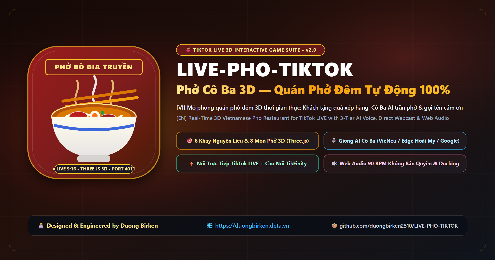
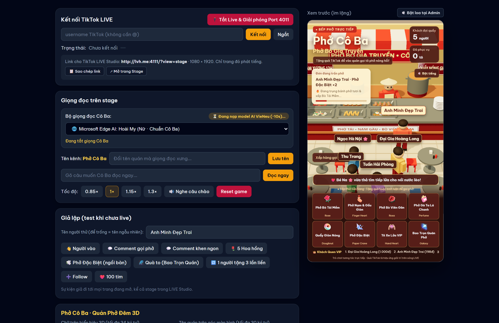
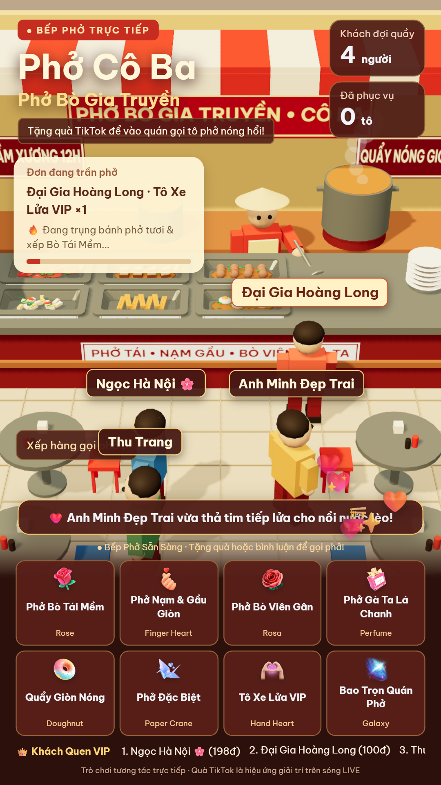
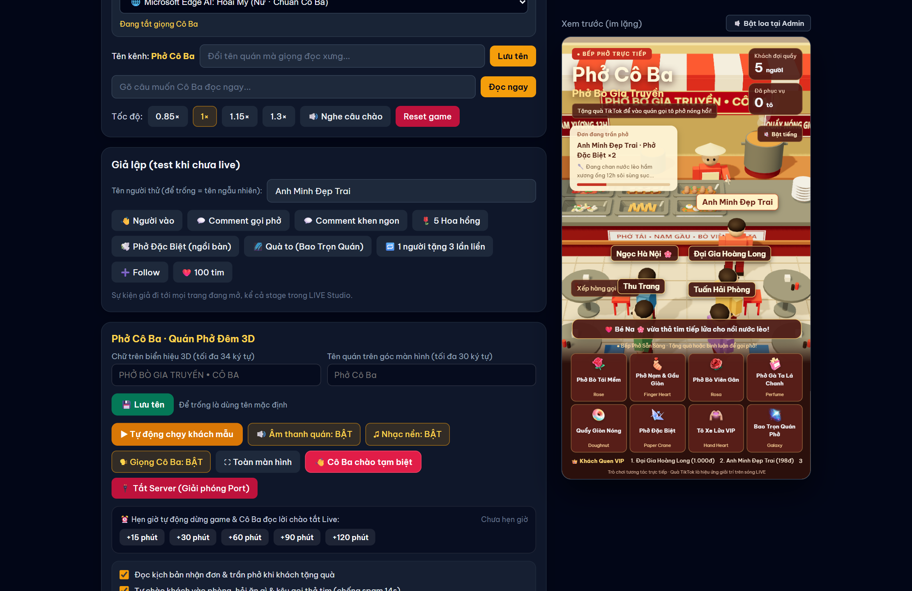
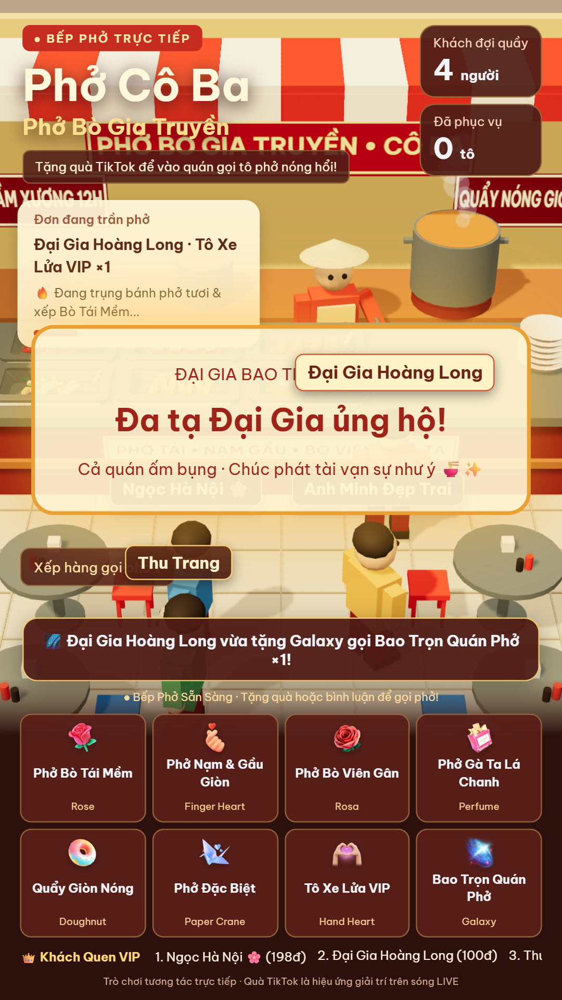

# 📖 CẨM NANG HƯỚNG DẪN SỬ DỤNG LIVE-PHO-TIKTOK TOÀN TẬP (A–Z)
## Phở Cô Ba 3D v2.0 — Bilingual End-User Manual (Tiếng Việt & English)

<div align="center">
  
</div>

> **🌐 Website Tác giả / Official Author Website:** [**Duong Birken — https://duongbirken.deta.vn**](https://duongbirken.deta.vn)  
> **📦 Kho mã nguồn & Tải về / GitHub Repository:** [**https://github.com/duongbirken2510/LIVE-PHO-TIKTOK**](https://github.com/duongbirken2510/LIVE-PHO-TIKTOK)  
> **📘 Hồ sơ Kiến trúc Công nghệ 10 Chương / Technical Whitepaper:** [**`info/Introduce_LivePhoTikTok.md`**](../info/Introduce_LivePhoTikTok.md)

---

## 📑 Mục Lục Nhanh / Quick Navigation
- **Phần A — 🇻🇳 Hướng Dẫn Sử Dụng Tiếng Việt (Từ A đến Z)**
  1. [Bước 1: Tải & Khởi chạy nhanh 1-Click trên Windows, macOS và Linux](#1-bước-1-tải--khởi-chạy-nhanh-1-click-trên-windows-macos-và-linux)
  2. [Bước 2: Thiết lập ban đầu, Kết nối TikTok LIVE & Đưa lên LIVE Studio](#2-bước-2-thiết-lập-ban-đầu-kết-nối-tiktok-live--đưa-lên-live-studio)
  3. [Bước 3: Tinh chỉnh Giọng đọc AI Cô Ba, Âm lượng 3 kênh & Kịch bản bán phở](#3-bước-3-tinh-chỉnh-giọng-đọc-ai-cô-ba-âm-lượng-3-kênh--kịch-bản-bán-phở)
  4. [Bước 4: Tùy biến Biển hiệu 3D, Giả lập khách mẫu & Hẹn giờ tự tắt Live](#4-bước-4-tùy-biến-biển-hiệu-3d-giả-lập-khách-mẫu--hẹn-giờ-tự-tắt-live)
  5. [Bước 5: Quản lý Lưu trữ Cài đặt, Tùy chỉnh Quà tặng & Sao lưu](#5-bước-5-quản-lý-lưu-trữ-cài-đặt-tùy-chỉnh-quà-tặng--sao-lưu)
  6. [Bước 6: Mẹo tối ưu RAM/GPU, Giải phóng Port 4011 & Xử lý sự cố thường gặp](#6-bước-6-mẹo-tối-ưu-ramgpu-giải-phóng-port-4011--xử-lý-sự-cố-thường-gặp)
- **Part B — 🇬🇧 English User Guide (Step-by-Step)**
  1. [Step 1: Quick Installation & 1-Click Launch (Windows, macOS, Linux)](#step-1-quick-installation--1-click-launch-windows-macos-linux)
  2. [Step 2: Connecting to TikTok LIVE & Adding the 9:16 Stage to LIVE Studio](#step-2-connecting-to-tiktok-live--adding-the-916-stage-to-live-studio)
  3. [Step 3: Configuring 3-Tier AI Voice, 3-Channel Audio Mixer & Auto-Shutdown Timer](#step-3-configuring-3-tier-ai-voice-3-channel-audio-mixer--auto-shutdown-timer)
  4. [Step 4: Settings Backup, Low-GPU Mode (`?lite=1`), Port Release & Troubleshooting](#step-4-settings-backup-low-gpu-mode-lite1-port-release--troubleshooting)

---

# 🇻🇳 PHẦN A — HƯỚNG DẪN SỬ DỤNG TIẾNG VIỆT (TỪ A ĐẾN Z)

## 1. Bước 1: Tải & Khởi chạy nhanh 1-Click trên Windows, macOS và Linux

### 💻 A. Trên máy tính Windows 10 / 11 (64-bit) — Khởi chạy 1-Click bằng `BAT-LIVE.bat`
1. Cài đặt **Node.js (bản 20 hoặc 22 LTS trở lên)** tại [https://nodejs.org](https://nodejs.org) (nếu máy bạn chưa cài).
2. Tải bộ mã nguồn dự án về máy bằng `git clone` hoặc tải file **Download ZIP** từ GitHub rồi giải nén ra ổ đĩa (ví dụ `D:\LIVE-PHO-TIKTOK`):
   ```bash
   git clone https://github.com/duongbirken2510/LIVE-PHO-TIKTOK.git
   cd LIVE-PHO-TIKTOK
   ```
3. Tại thư mục gốc của dự án, **nhấp đúp chuột vào file `BAT-LIVE.bat`** (hoặc `CHAY_QUAN_PHO_3D.bat`):
   - **Nếu Windows hiện bảng xanh *Windows protected your PC (SmartScreen)*:** Bấm vào chữ **More info** (*Thông tin thêm*) ➔ bấm nút **Run anyway** (*Vẫn chạy*).
   - Lần đầu tiên mở, phần mềm sẽ tự động tải thư viện kết nối TikTok LIVE và giọng đọc Microsoft Edge AI trong khoảng 10–15 giây.
   - Ngay sau đó, trình duyệt sẽ tự động mở **Trang Admin Điều Khiển** tại địa chỉ: **`http://localhost:4011`**.

### 🍎 B. Trên máy MacBook / iMac (macOS)
1. Mở **Terminal**, di chuyển vào thư mục dự án và chạy lệnh:
   ```bash
   cd LIVE-PHO-TIKTOK/games/curry-shop-3d
   npm install
   PORT=4011 BRIDGE_PORT=4012 node server.mjs
   ```
2. Nếu bạn đóng gói hoặc chạy ứng dụng `.app` trên macOS bị Gatekeeper cảnh báo, chạy lệnh sau trong Terminal để mở khóa nhanh:
   ```bash
   xattr -cr "/Applications/TikTokLiveGameDesk.app"
   ```

### 🐧 C. Trên máy tính Linux (Ubuntu / Debian / Mint / Fedora)
```bash
cd LIVE-PHO-TIKTOK/games/curry-shop-3d
npm install
PORT=4011 BRIDGE_PORT=4012 node server.mjs
# Mở trình duyệt Chrome truy cập: http://localhost:4011
```

---

## 2. Bước 2: Thiết lập ban đầu, Kết nối TikTok LIVE & Đưa lên LIVE Studio



Khi trang **`http://localhost:4011`** mở ra, bạn sẽ thấy **cột bên trái là 5 Thẻ Điều Khiển** và **cột bên phải là Khung Xem Trước Quán Phở 3D (9:16)**. Hãy thực hiện 3 thao tác sau tại **Thẻ số 1 (`Kết nối TikTok LIVE`)**:

1. **Đưa màn hình Quán Phở 3D vào TikTok LIVE Studio (hoặc OBS Studio):**
   - Trong thẻ **Kết nối TikTok LIVE**, bấm nút **`📋 Sao chép link`** để chép địa chỉ:
     ```text
     http://lvh.me:4011/?view=stage
     ```
   - Mở phần mềm **TikTok LIVE Studio**, chọn chế độ màn hình **Dọc (`9:16 — 1080 × 1920`)**.
   - Bấm **Thêm nguồn (Add Source)** ➔ chọn **Liên kết (Link / Browser Source)**.
   - Dán địa chỉ `http://lvh.me:4011/?view=stage` vào ô URL, đặt kích thước **`1080 × 1920`** rồi căn kín khung hình.
   - *(Mẹo hay: Địa chỉ `lvh.me` luôn trỏ thẳng về máy tính của bạn giống `localhost`, nhưng giúp vượt qua hoàn toàn lỗi chặn từ khóa `localhost` của TikTok LIVE Studio!)*
2. **Kết nối trực tiếp với phòng LIVE của bạn:**
   - Sau khi bạn bấm **Phát trực tiếp (Go LIVE)** trên TikTok LIVE Studio, quay lại trang Admin `http://localhost:4011`.
   - Tại ô **`username TikTok (không cần @)`**, nhập ID kênh TikTok của bạn (ví dụ: `phocoba.official`) rồi bấm nút màu xanh **`Kết nối`**.
   - Dòng trạng thái sẽ chuyển sang màu xanh lá: **`Đang live @username · X người xem · Y tim`**.
3. **Hoặc dùng cầu nối TikFinity (Tùy chọn phụ trợ):**
   - Nếu bạn đang dùng phần mềm **TikFinity Desktop** (bật Event API ở cổng `21213`), quán phở sẽ **tự động nhận diện** và hiện nhãn xanh `TikFinity: ●` ngay bên cạnh dòng trạng thái mà không cần cài đặt gì thêm.

---

## 3. Bước 3: Tinh chỉnh Giọng đọc AI Cô Ba, Âm lượng 3 kênh & Kịch bản bán phở



Tại **Thẻ số 2 (`Giọng đọc trên stage`)** và **Thẻ số 4 (`Phở Cô Ba · Quán Phở Đêm 3D`)**, bạn có thể điều khiển toàn bộ âm thanh của quán:

1. **Chọn giọng đọc cho Cô Ba:**
   - Nhấp vào menu thả xuống dưới dòng **`Bộ giọng đọc Cô Ba:`**:
     - `🌐 Microsoft Edge AI: Hoài My (Nữ · Chuẩn Cô Ba)` *(Mặc định — giọng nữ miền Nam/Bắc trong trẻo, đon đả)*.
     - `🌐 Microsoft Edge AI: Nam Minh (Nam · Ông Chủ)` *(Giọng nam trầm ấm nếu bạn muốn đóng vai Ông Chủ quán phở)*.
     - `🌐 Google Tiếng Việt (Chị Google)` *(Giọng chị Google quen thuộc, vui nhộn)*.
     - `🎙️ VieNeu AI` *(Tự động xuất hiện thêm 25 giọng AI local nếu máy bạn có cài thư mục `VieNeu-TTS`)*.
2. **Đổi tên xưng hô & Cho Cô Ba đọc câu bất kỳ ngay lập tức:**
   - Tại ô **`Đổi tên quán mà giọng đọc xưng...`**, nhập tên kênh của bạn (ví dụ: *Phở Đêm Sài Gòn*) rồi bấm **`Lưu tên`** — trong mọi câu chào và câu cảm ơn, Cô Ba sẽ tự xưng theo tên mới này.
   - Tại ô **`Gõ câu muốn Cô Ba đọc ngay...`**, bạn có thể gõ bất kỳ lời nhắn nào tới người xem trên live rồi bấm **`Đọc ngay`** (hoặc nhấn phím `Enter`) để Cô Ba phát thanh trực tiếp trên sóng!
   - Chọn tốc độ đọc: **`0.85×`**, **`1×`**, **`1.15×`** hoặc **`1.3×`** và bấm **`🔊 Nghe câu chào`** để nghe thử ngay.
3. **Điều chỉnh 3 kênh âm thanh độc lập & Tự động hạ nhạc nền (Auto-Ducking):**
   - **3 nút bật/tắt nhanh:**
     - `🔊 Âm thanh quán: BẬT/TẮT` (Công tắc tổng cho toàn bộ âm thanh).
     - `♫ Nhạc nền: BẬT/TẮT` (Bật/tắt bản nhạc nền 90 BPM không bản quyền).
     - `🗣 Giọng Cô Ba: BẬT/TẮT` (Bật/tắt giọng đọc AI).
   - **3 thanh trượt âm lượng (`0% – 100%`):**
     - **Nhạc nền** (Mặc định `12%`): Nhạc dạo nhẹ nhàng, tự động hạ nhỏ xuống `5%` mỗi khi Cô Ba cất giọng nói.
     - **Tiếng bếp** (Mặc định `35%`): Tiếng bước chân khách, chuông nhận đơn, tiếng muôi múc nước lèo, tiếng đặt tô sứ và kéo ghế nhựa.
     - **Giọng Cô Ba** (Mặc định `100%`): Âm lượng giọng đọc AI (được tự động khuếch đại `1.55×` để luôn rõ lời nhất).
   - **3 ô tích chọn kịch bản tự động:**
     - `[x] Đọc kịch bản nhận đơn & trần phở khi khách tặng quà`
     - `[x] Tự chào khách vào phòng, hỏi ăn gì & kêu gọi thả tim (chống spam 14s)`
     - `[x] Tự rao hàng kêu gọi tương tác khi quán vắng (mỗi 40s)`

---

## 4. Bước 4: Tùy biến Biển hiệu 3D, Giả lập khách mẫu & Hẹn giờ tự tắt Live



1. **Đổi chữ trên Biển hiệu 3D ngay trong lúc đang LIVE:**
   - Tại **Thẻ số 4**, nhập nội dung mới vào 2 ô:
     - **`Chữ trên biển hiệu 3D (tối đa 34 ký tự)`**: Ví dụ `PHỞ BÒ GIA TRUYỀN • CÔ BA`
     - **`Tên quán trên góc màn hình (tối đa 30 ký tự)`**: Ví dụ `Phở Cô Ba`
   - Bấm nút màu xanh lá **`💾 Lưu tên`** — tấm biển gỗ đỏ chữ vàng treo giữa quán phở 3D sẽ đổi chữ mới ngay tức khắc!
2. **Thử nghiệm hiệu ứng trước khi lên sóng (`Thẻ số 3: Giả lập`)**:
   - Nhập tên người xem thử vào ô **`Tên người thử`** (ví dụ: *Anh Minh Đẹp Trai*) rồi bấm bất kỳ nút nào:
     - `👋 Người vào` · `💬 Comment gọi phở` · `💬 Comment khen ngon`
     - `🌹 5 Hoa hồng` · `🕊️ Phở Đặc Biệt (ngồi bàn)` · `🌌 Quà to (Bao Trọn Quán)`
     - `🔁 1 người tặng 3 lần liền` · `➕ Follow` · `❤️ 100 tim`
   - Hoặc bấm nút màu cam **`▶ Tự động chạy khách mẫu`** để khách 3D tự động đi vào gọi đủ 8 món phở liên tục giúp màn hình luôn nhộn nhịp ngay cả khi phòng live mới mở! (Khi có khách thật tặng quà, đơn thật sẽ tự động được ưu tiên làm trước đơn khách mẫu).



3. **Bảng Thực Đơn 8 Món Phở Gắn Quà TikTok:**
   - **🌹 Rose (1 xu):** *Phở Bò Tái Mềm* (Mang đi)
   - **🫰 Finger Heart (5 xu):** *Phở Nạm & Gầu Giòn* (Mang đi)
   - **🌷 Rosa (10 xu):** *Phở Bò Viên Gân* (Mang đi)
   - **🌶️ Perfume (20 xu):** *Phở Gà Ta Lá Chanh* (Mang đi)
   - **🍩 Doughnut (30 xu):** *Quẩy Giòn Nóng* (Mang đi)
   - **🕊️ Paper Crane (99 xu):** *Phở Đặc Biệt* (Bò Tái + Nạm Gầu + Bò Viên — **Khách bưng tô ra bàn inox ngồi ăn 9 giây**)
   - **🫶 Hand Heart (100 xu):** *Tô Xe Lửa VIP* (Bò Tái + Quẩy + Trứng Chần — **Khách bưng tô ra bàn inox ngồi ăn 9 giây**)
   - **🌌 Galaxy / Sư tử (1000 xu):** *Bao Trọn Quán Phở* (Đủ cả 6 khay nguyên liệu + **Băng rôn vàng "ĐẠI GIA BAO TRỌN QUÁN!"** + Cô Ba đọc lời chúc Đại Gia).
4. **Hẹn giờ tự động dừng game & Cô Ba chào tắt Live (Khi treo máy ban đêm):**
   - Trong khung **`⏰ Hẹn giờ tự động dừng game & Cô Ba đọc lời chào tắt Live`**, bấm chọn một trong các mốc: **`+15 phút`**, **`+30 phút`**, **`+60 phút`**, **`+90 phút`**, hoặc **`+120 phút`**.
   - Đồng hồ đếm ngược sẽ chạy trực tiếp trên màn hình. Khi hết giờ (hoặc khi bạn bấm nút **`👋 Cô Ba chào tạm biệt`**), quán sẽ dừng nhận khách mẫu và Cô Ba tự động đọc lời cảm ơn khán giả, chúc cả nhà ngủ ngon để kết thúc buổi live trọn vẹn.

---

## 5. Bước 5: Quản lý Lưu trữ Cài đặt, Tùy chỉnh Quà tặng & Sao lưu

1. **Tự động lưu giữ toàn bộ cấu hình (`settings.json`):**
   - Mọi thiết lập của bạn (Tên kênh, `username` TikTok, Chữ biển hiệu 3D, Giọng đọc Cô Ba, Tốc độ đọc, Âm lượng 3 kênh, Công tắc kịch bản) đều được lưu tự động vào file **`settings.json`** ở thư mục gốc của dự án (chỉ chiếm `< 1 KB`, hoàn toàn không làm đầy ổ C).
2. **Cách sao lưu hoặc chuyển toàn bộ dự án sang ổ đĩa khác / máy tính khác:**
   - Dự án được thiết kế dạng **Portable (Di động 100%)**: Bạn chỉ cần copy toàn bộ thư mục `LIVE-PHO-TIKTOK` (kèm file `settings.json` và `games/curry-shop-3d/gift-map.json`) sang ổ `D:\`, `E:\` hoặc USB rồi bấm `BAT-LIVE.bat` là chạy ngay với đầy đủ biển hiệu và giọng đọc đã cài.
3. **Cách đổi danh sách 8 món quà TikTok (`gift-map.json`):**
   - Mở file `games/curry-shop-3d/gift-map.json` bằng Notepad để thay tên hoặc ID quà TikTok tương ứng với 8 mã món ăn (`incense`, `temple`, `tree`, `fruit`, `lamp`, `lantern`, `bell`, `grand`).

---

## 6. Bước 6: Mẹo tối ưu RAM/GPU, Giải phóng Port 4011 & Xử lý sự cố thường gặp

1. **Cách tắt Server và giải phóng hoàn toàn Port 4011 / 4012 trong 1 giây:**
   - **Cách 1 (Ngay trên trình duyệt):** Bấm nút màu đỏ **`🔌 Tắt Live & Giải phóng Port 4011`** ở góc trên bên phải Thẻ số 1 (hoặc nút `🔌 Tắt Server (Giải phóng Port)` ở Thẻ số 4).
   - **Cách 2 (Bằng file `.bat`):** Nhấp đúp vào file **`TAT-LIVE.bat`** (hoặc `DUNG_QUAN_PHO_3D.bat`) ở thư mục gốc. Toàn bộ tiến trình Node.js và cổng `4011` / `4012` sẽ được đóng sạch sẽ 100%.
2. **Mẹo giảm tải GPU/CPU cho máy tính cấu hình vừa hoặc laptop (`Chế độ Lite 30 FPS`):**
   - Khi thêm link vào TikTok LIVE Studio, bạn chỉ cần thêm `&lite=1` vào cuối đường dẫn:
     ```text
     http://lvh.me:4011/?view=stage&lite=1
     ```
   - Chế độ `lite=1` sẽ giới hạn tốc độ dựng hình ở `30 FPS`, tắt đổ bóng thời gian thực (`shadowMap`) và hạ `pixelRatio = 1`, giúp giảm hơn **50% tải GPU/CPU** mà hình ảnh quán phở vẫn sắc nét!
3. **Xử lý sự cố thường gặp:**
   - **Đang ở trang Admin bấm giả lập mà không nghe thấy tiếng?**
     - Mặc định trang Admin ở chế độ `Xem trước (im lặng)` để nhường loa cho trang Stage trong LIVE Studio. Nếu bạn muốn nghe trực tiếp trên trang Admin, hãy bấm nút **`🔈 Bật loa tại Admin`** ở góc trên khung Xem trước 3D!
   - **Báo lỗi *"TikTok báo tài khoản này CHƯA LIVE"* khi bấm Kết nối?**
     - Bạn cần bấm nút **Phát trực tiếp (Go LIVE)** trong phần mềm TikTok LIVE Studio trước, đợi khoảng 5 giây cho phiên live lên sóng rồi mới bấm nút **Kết nối** trên trang Admin.

---

# 🇬🇧 PART B — ENGLISH USER GUIDE (STEP-BY-STEP)

## Step 1: Quick Installation & 1-Click Launch (Windows, macOS, Linux)

- **Windows 10/11 (64-bit):**
  1. Install **Node.js 20+ or 22+ LTS** from [https://nodejs.org](https://nodejs.org).
  2. Clone or extract the repository:
     ```bash
     git clone https://github.com/duongbirken2510/LIVE-PHO-TIKTOK.git
     cd LIVE-PHO-TIKTOK
     ```
  3. Double-click **`BAT-LIVE.bat`** (or **`CHAY_QUAN_PHO_3D.bat`**). If Windows SmartScreen appears, click **More info** ➔ **Run anyway**.
  4. On first launch, dependencies (`tiktok-live-connector` & `msedge-tts`) install automatically, and your browser opens the Admin Dashboard at **`http://localhost:4011`**.
- **macOS & Linux:**
  ```bash
  cd LIVE-PHO-TIKTOK/games/curry-shop-3d
  npm install
  PORT=4011 BRIDGE_PORT=4012 node server.mjs
  ```
  *(On macOS, if running a packaged `.app` bundle blocked by Gatekeeper, run `xattr -cr "/Applications/TikTokLiveGameDesk.app"` in Terminal).*

---

## Step 2: Connecting to TikTok LIVE & Adding the 9:16 Stage to LIVE Studio


1. **Add the Vertical 3D Stage to TikTok LIVE Studio / OBS:**
   - In Card 1 (**Kết nối TikTok LIVE**), click **`📋 Sao chép link`** to copy the stage URL:
     ```text
     http://lvh.me:4011/?view=stage
     ```
   - In **TikTok LIVE Studio**, add a **Link / Browser Source** set to **`1080 × 1920`** (portrait `9:16`) and paste `http://lvh.me:4011/?view=stage`.
   - *(Note: `lvh.me` resolves directly to `127.0.0.1` on your machine while bypassing TikTok LIVE Studio's `localhost` filter).*
2. **Connect Your TikTok Account:**
   - Once your stream is live in TikTok LIVE Studio, type your TikTok handle (without `@`) into **`username TikTok`** and click **`Kết nối`** (Connect).
   - Alternatively, if you run **TikFinity Desktop** with WebSocket Event API enabled on port `21213`, the built-in bridge (`Port 4012`) connects automatically.

---

## Step 3: Configuring 3-Tier AI Voice, 3-Channel Audio Mixer & Auto-Shutdown Timer


1. **Select AI Voice (`Card 2: Giọng đọc trên stage`):**
   - Choose between **Microsoft Edge Neural Hoài My (Female — Cô Ba)**, **Microsoft Edge Neural Nam Minh (Male)**, **Google Vietnamese TTS**, or local **VieNeu-TTS AI voices**.
   - Type any custom announcement into **`Gõ câu muốn Cô Ba đọc ngay...`** and click **`Đọc ngay`** to make Cô Ba speak live on stream immediately.
2. **3-Channel Audio Mixer & Automatic Voice Ducking (`Card 4`):**
   - Adjust the 3 independent sliders: **Background Music (`Nhạc nền`, default `12%`)**, **Kitchen Sound Effects (`Tiếng bếp`, default `35%`)**, and **Cô Ba AI Voice (`Giọng Cô Ba`, default `100%`)**.
   - Whenever Cô Ba speaks, **Auto-Ducking** smoothly lowers background music to `5%` and boosts voice gain by `1.55×`.
   - To preview audio directly inside the Admin Dashboard before opening LIVE Studio, click **`🔈 Bật loa tại Admin`** above the right-hand 3D preview. As soon as `/?view=stage` opens in LIVE Studio, the Admin preview automatically mutes itself to prevent double audio echo.
3. **Customize the 3D Signboard & Set the Auto-Shutdown Timer:**
   - Enter your custom 3D signboard text (`up to 34 characters`) and shop title (`up to 30 characters`) in Card 4 and click **`💾 Lưu tên`** — the 3D WebGL sign updates live without refreshing.
   - Use the **`+15 phút` .. `+120 phút`** timer pills to automatically stop demo traffic and have Cô Ba deliver a warm closing farewell message when your scheduled stream ends.

---

## Step 4: Settings Backup, Low-GPU Mode (`?lite=1`), Port Release & Troubleshooting


- **Portable Configuration Backup:** All channel names, 3D signboard text, voice selections, and audio mixer levels are saved automatically in **`settings.json`** at the project root (`< 1 KB`). Copy the project folder to any drive (`D:\`, external SSD) to migrate your entire setup with zero data loss.
- **Low-GPU / Laptop Mode (`?lite=1`):** Append `&lite=1` to the stage URL (`http://lvh.me:4011/?view=stage&lite=1`) to cap rendering at `30 FPS` and disable real-time shadows for ultra-low GPU usage.
- **1-Click Server Shutdown & Port 4011 Release:** Click the red **`🔌 Tắt Live & Giải phóng Port 4011`** button directly in the web dashboard, or double-click **`TAT-LIVE.bat`** (or **`DUNG_QUAN_PHO_3D.bat`**) to cleanly terminate the server and free ports `4011` and `4012`.

---

## 👨‍💻 Tác Giả & Liên Hệ / Author & Contact

| 🇻🇳 Lời nhắn từ Tác giả | 🇬🇧 Note from the Author |
| :--- | :--- |
| **LIVE-PHO-TIKTOK (`Phở Cô Ba 3D`)** được phát triển bởi **Duong Birken**. Nếu bạn thấy dự án hữu ích, hãy tặng một **⭐ Star** trên GitHub và ghé thăm website chính thức để xem thêm các công cụ livestream tự động hóa nhé! | **LIVE-PHO-TIKTOK (`Phở Cô Ba 3D`)** is developed by **Duong Birken**. If you find this project helpful, please give it a **⭐ Star** on GitHub and visit the official website for more interactive livestream tools! |

- **🌐 Website:** [**https://duongbirken.deta.vn**](https://duongbirken.deta.vn)
- **📦 GitHub:** [**https://github.com/duongbirken2510/LIVE-PHO-TIKTOK**](https://github.com/duongbirken2510/LIVE-PHO-TIKTOK)
