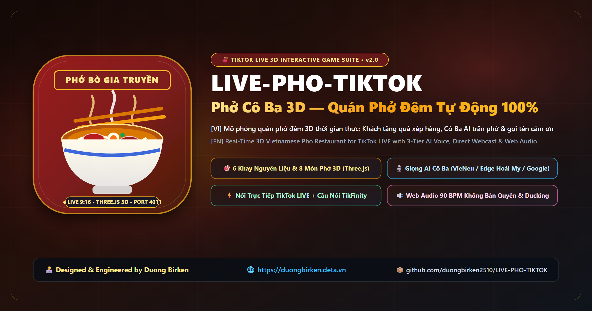

# 🍜 Phở Cô Ba 3D — Quán Phở Đêm Tương Tác TikTok LIVE (`games/curry-shop-3d`)
## Real-Time 3D Vietnamese Night Pho Restaurant for TikTok LIVE (Port 4011 / Bridge 4012)

<div align="center">
  
</div>

> **🌐 Tác giả / Author:** **Duong Birken** — [https://duongbirken.deta.vn](https://duongbirken.deta.vn)  
> **📖 Hướng dẫn Sử dụng Toàn tập (A–Z User Guide):** [`../../docs/USER_GUIDE.md`](../../docs/USER_GUIDE.md)  
> **📘 Hồ sơ Công nghệ 10 Chương (Technical Whitepaper):** [`../../info/Introduce_LivePhoTikTok.md`](../../info/Introduce_LivePhoTikTok.md)

---

## 🇻🇳 1. Giới Thiệu Nhanh (Tiếng Việt)

Thư mục `games/curry-shop-3d` chứa mã nguồn lõi của **Phở Cô Ba 3D (`Live-Pho v2.0`)** — trò chơi mô phỏng quán phở đêm Việt Nam 3D tương tác thời gian thực trên sóng **TikTok LIVE**:
- **Khởi chạy 1-Click từ thư mục gốc:** Nhấp đúp `BAT-LIVE.bat` (hoặc `CHAY_QUAN_PHO_3D.bat`).
- **Trang Admin Điều Khiển:** `http://localhost:4011`
- **Link Nguồn Trình Duyệt (TikTok LIVE Studio / OBS — `1080 × 1920`):** `http://lvh.me:4011/?view=stage` *(hoặc thêm `&lite=1` cho máy cấu hình yếu)*.
- **Tắt Server & Giải phóng Port 4011:** Bấm nút đỏ **`🔌 Tắt Live & Giải phóng Port 4011`** ngay trên trang Admin hoặc chạy `TAT-LIVE.bat` ở thư mục gốc.

### Thực Đơn 8 Món Phở Gắn Quà TikTok

| Quà TikTok | Món Phở 3D | Phục Vụ |
| :--- | :--- | :--- |
| 🌹 **Rose** (1 xu) | **Phở Bò Tái Mềm** | Nhận tô tại quầy (+1đ) |
| 🫰 **Finger Heart** (5 xu) | **Phở Nạm & Gầu Giòn** | Nhận tô tại quầy (+5đ) |
| 🌷 **Rosa** (10 xu) | **Phở Bò Viên Gân** | Nhận tô tại quầy (+10đ) |
| 🌶️ **Perfume** (20 xu) | **Phở Gà Ta Lá Chanh** | Nhận tô tại quầy (+20đ) |
| 🍩 **Doughnut** (30 xu) | **Quẩy Giòn Nóng** | Nhận tô tại quầy (+30đ) |
| 🕊️ **Paper Crane** (99 xu) | **Phở Đặc Biệt** *(Tái + Nạm Gầu + Bò Viên)* | 🪑 Bưng tô ra bàn inox ngồi ăn 9 giây (+99đ) |
| 🫶 **Hand Heart** (100 xu) | **Tô Xe Lửa VIP** *(Tái + Quẩy + Trứng Chần)* | 🪑 Bưng tô ra bàn inox ngồi ăn 9 giây (+100đ) |
| 🌌 **Galaxy / Sư tử** (1000 xu) | **Bao Trọn Quán Phở** *(Đủ 6 khay nguyên liệu)* | 🪑 Ngồi bàn 9s + Băng rôn **ĐẠI GIA BAO TRỌN QUÁN!** (+1000đ) |

---

## 🇬🇧 2. Quick Overview (English)

`games/curry-shop-3d` powers **Phở Cô Ba 3D (`Live-Pho v2.0`)**, a vertical `1080 × 1920` Three.js r170 WebGL interactive game for TikTok LIVE:
- **Admin Dashboard:** `http://localhost:4011`
- **TikTok LIVE Studio Stage URL (`1080 × 1920`):** `http://lvh.me:4011/?view=stage`
- **Direct TikTok LIVE Connection + TikFinity Bridge:** Connect directly by TikTok `@username` on port `4011` or via TikFinity WebSocket (`ws://127.0.0.1:21213/`) bridged through port `4012`.
- **3-Tier Vietnamese AI Voice & Procedural Web Audio:** Supports local `VieNeu-TTS`, `Microsoft Edge Neural (Hoài My / Nam Minh)`, and `Google Vietnamese TTS` with a 16-bar `90 BPM` procedural music synthesizer, 7 kitchen sound effects, and automatic voice ducking.

### Running Unit Tests
```bash
node --test game.test.mjs seller-voice.test.mjs audio.test.mjs audio-controls.test.mjs
```
