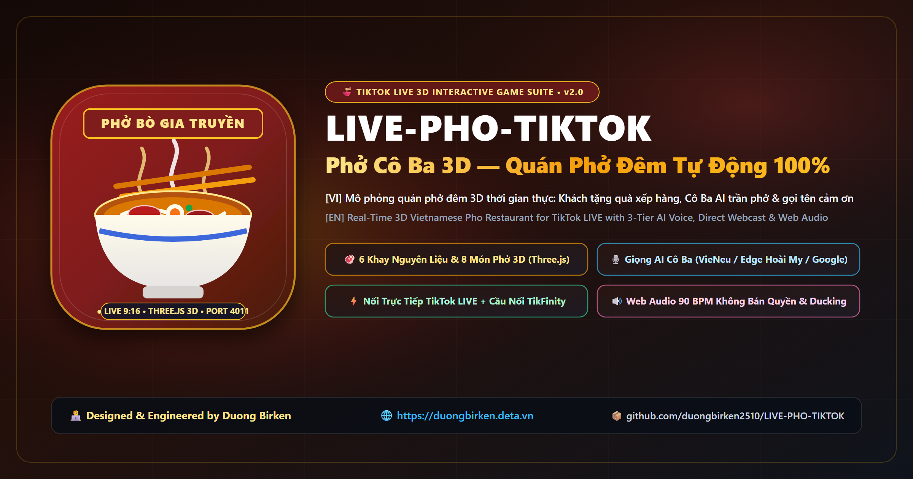
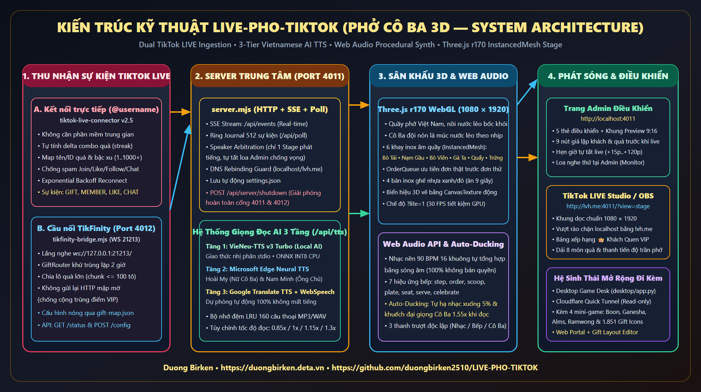
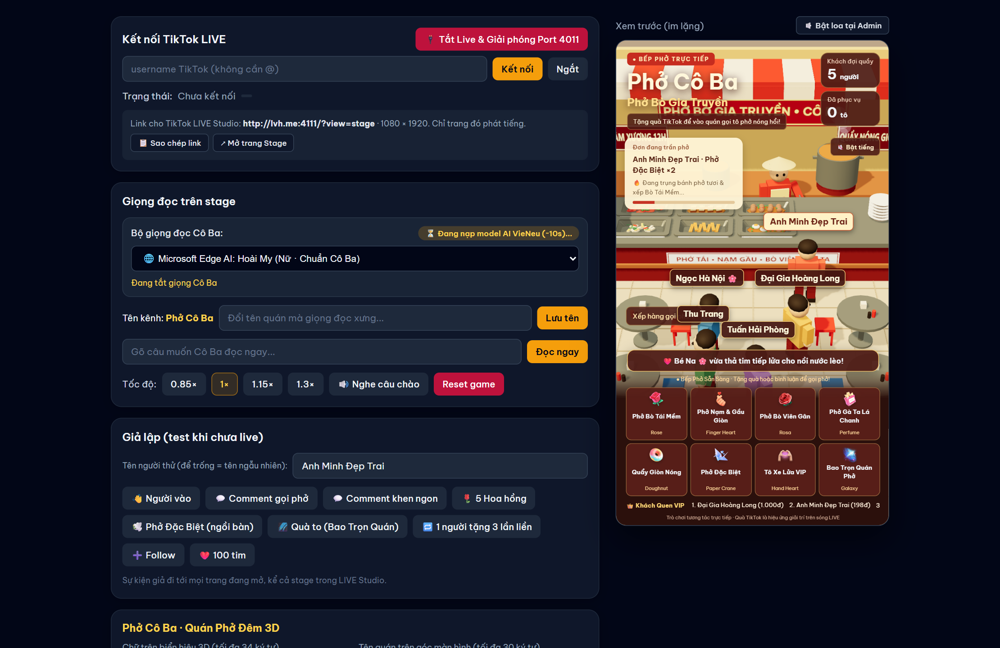
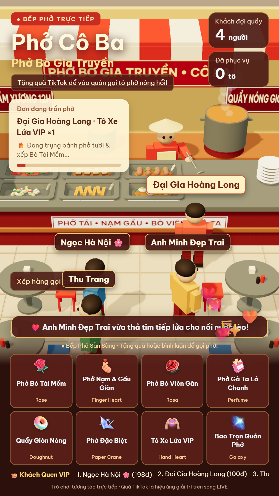
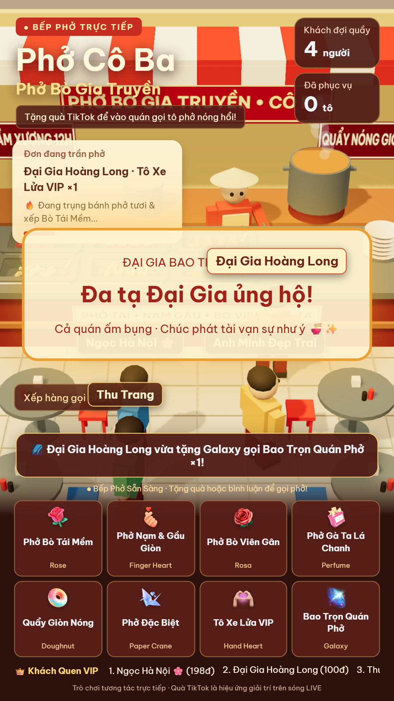
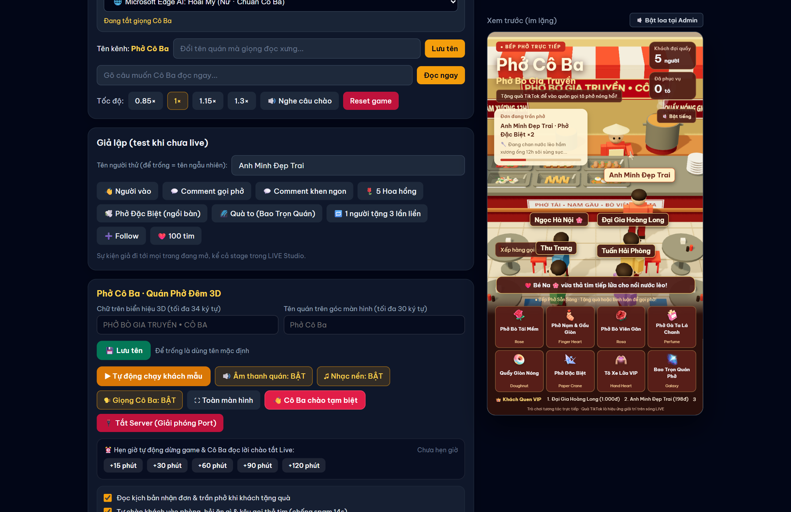

# 🌱 HỒ SƠ GIỚI THIỆU SẢN PHẨM & CÔNG NGHỆ: LivePhoTikTok — Phở Cô Ba 3D (v2.0)
## Product & Technical Whitepaper (Song Ngữ Tiếng Việt & English)

  

> **Khẩu hiệu (Tagline):** *"Quán Phở Đêm 3D Tương Tác Thời Gian Thực — Tự Động 100% Cùng Giọng Đọc AI Cô Ba Trên Sóng TikTok LIVE"*  
> **English Tagline:** *"Real-Time 3D Vietnamese Night Pho Restaurant Interactive Game for TikTok LIVE with 3-Tier AI Voice & Procedural Web Audio"*  
> **Nền tảng hỗ trợ (Platforms):** Windows 10/11 · Node.js 20/22+ · Three.js r170 WebGL · TikTok LIVE Studio / OBS (`1080 × 1920`)  
> **Tác giả & Website chính thức (Author):** **Duong Birken** — [https://duongbirken.deta.vn](https://duongbirken.deta.vn)  
> **Kho mã nguồn & Tải về (Repository):** [https://github.com/duongbirken2510/LIVE-PHO-TIKTOK](https://github.com/duongbirken2510/LIVE-PHO-TIKTOK)  
> **Cẩm nang Hướng dẫn Sử dụng (A–Z User Guide):** [`docs/USER_GUIDE.md`](../docs/USER_GUIDE.md)

---

## 📑 Mục Lục Nhanh / Table of Contents
1. [LivePhoTikTok (Phở Cô Ba 3D) là gì? / What is LivePhoTikTok?](#1-livephotiktok-phở-cô-ba-3d-là-gì--what-is-livephotiktok)
2. [Các Tính Năng Chính Cung Cấp Cho Người Dùng / Core Feature Matrix](#2-các-tính-năng-chính-cung-cấp-cho-người-dùng--core-feature-matrix)
3. [Lợi Ích Mang Lại — Giải Quyết Triệt Để Những "Nỗi Đau" Gì? / Pain Points Solved](#3-lợi-ích-mang-lại--giải-quyết-triệt-để-những-nỗi-đau-gì--pain-points-solved)
4. [Kịch Bản Thực Tế: Một Phiên Phát Sóng Tiêu Biểu / A Day in the Life](#4-kịch-bản-thực-tế-một-phiên-phát-sóng-tiêu-biểu--a-day-in-the-life)
5. [Kỹ Thuật & Công Nghệ Chuyên Sâu Bên Dưới / Deep-Dive Technical Architecture](#5-kỹ-thuật--công-nghệ-chuyên-sâu-bên-dưới--deep-dive-technical-architecture)
6. [Hiệu Quả Công Nghệ & Trải Nghiệm Người Dùng / Benchmark Comparison](#6-hiệu-quả-công-nghệ--trải-nghiệm-người-dùng--benchmark-comparison)
7. [Cam Kết Quyền Riêng Tư & An Toàn Nội Dung / Privacy & Stream Safety Guarantee](#7-cam-kết-quyền-riêng-tư--an-toàn-nội-dung--privacy--stream-safety-guarantee)
8. [Thư Viện Hình Ảnh Giao Diện Thực Tế / Visual Showcase](#8-thư-viện-hình-ảnh-giao-diện-thực-tế--visual-showcase)
9. [Cấu Hình Yêu Cầu & Câu Hỏi Thường Gặp / System Requirements & FAQ](#9-cấu-hình-yêu-cầu--câu-hỏi-thường-gặp--system-requirements--faq)
10. [Lộ Trình Phát Triển Tiếp Theo & Liên Hệ Tác Giả / Roadmap & Author Contact](#10-lộ-trình-phát-triển-tiếp-theo--liên-hệ-tác-giả--roadmap--author-contact)

---

## 1. LivePhoTikTok (Phở Cô Ba 3D) là gì? / What is LivePhoTikTok?

### 🇻🇳 Tiếng Việt
**LIVE-PHO-TIKTOK (`Phở Cô Ba 3D — Live-Pho v2.0`)** là nền tảng trò chơi mô phỏng **Quán Phở Đêm Việt Nam 3D** tương tác thời gian thực tự động 100% dành riêng cho **TikTok LIVE**, đi kèm bộ công cụ 5 trò chơi tương tác và hệ thống quản lý quà tặng TikTok.

- **Đối tượng người dùng mục tiêu:**
  - Các nhà sáng tạo nội dung (**TikTok LIVE Creators / Streamers**) muốn vận hành kênh livestream giải trí tương tác 24/7 thu hút quà tặng, bình luận và lượt thả tim mà không cần ngồi trước ống kính liên tục.
  - Các chủ quán ăn, kênh ẩm thực hoặc cộng đồng giải trí đêm khuya muốn tạo không gian văn hóa ẩm thực đường phố Việt Nam ấm cúng, gần gũi trên sóng trực tiếp.
- **Triết lý thiết kế cốt lõi:**
  1. **Đậm đà bản sắc phở đêm Việt Nam trên đồ họa WebGL 3D:** Tái hiện chi tiết quầy phở inox với **nồi nước lèo hầm xương 12h nghi ngút khói**, **Cô Ba đội nón lá** cầm muôi múc nước phở, **6 khay inox âm quầy** đựng *Bò Tái Mềm, Nạm & Gầu Giòn, Bò Viên Gân, Gà Ta Lá Chanh, Quẩy Giòn Nóng, Trứng Chần & Hành*, cùng **4 bàn inox ghế nhựa xanh/đỏ** để khách ngồi xì xụp tô phở nóng.
  2. **Giọng đọc AI Cô Ba tự nhiên & Kịch bản bán hàng thông minh:** Tự động xướng tên người xem khi vào phòng, cảm ơn khi thả tim/follow, đọc quy trình trụng bánh phở – đập gừng nướng khi khách tặng quà gọi món, và tự động rao hàng mỗi `40 giây` khi quán vắng.
  3. **Kiến trúc 1-Click chuẩn `LIVE-TRANGNGUYEN`:** Bật toàn bộ Server + AI Voice + Trình duyệt bằng 1 cú nhấp đúp `BAT-LIVE.bat` trên cổng `4011` và tắt sạch tiến trình/giải phóng cổng bằng nút **`🔌 Tắt Live & Giải phóng Port 4011`** ngay trên giao diện web hoặc `TAT-LIVE.bat`.

### 🇬🇧 English
**LIVE-PHO-TIKTOK (`Phở Cô Ba 3D — Live-Pho v2.0`)** is a 100% automated, real-time **3D Vietnamese Night Pho Restaurant** interactive livestream game built for **TikTok LIVE**, bundled alongside a multi-game interactive suite, desktop launcher, and a 1,851-item TikTok gift library.

- **Target Audience:** TikTok LIVE creators, automated 24/7 interactive stream operators, and gaming/food streamers looking for a culturally rich, zero-copyright, high-engagement vertical (`1080 × 1920`) interactive stage.
- **Core Philosophy:**
  1. **Procedural 3D Vietnamese Street-Food Realism:** Built on `Three.js r170` with `InstancedMesh` optimization, featuring a steaming 12-hour bone broth cauldron, **Cô Ba** wearing a traditional Vietnamese conical hat (`nón lá`), 6 recessed stainless-steel ingredient trays, and 4 stainless-steel dining tables with iconic red and blue plastic stools.
  2. **3-Tier Vietnamese AI Voice Host (`Cô Ba`):** Seamlessly orchestrates local `VieNeu-TTS v3 Turbo (ONNX INT8)`, `Microsoft Edge Neural TTS (Hoài My / Nam Minh)`, and `Google Translate TTS` with automatic background music ducking (`5%` music volume + `1.55×` voice boost while speaking).
  3. **Zero-Friction 1-Click Operation:** Starts on port `4011` via `BAT-LIVE.bat`, connects directly to TikTok LIVE via `@username` (or via `TikFinity Bridge` on port `4012`), and cleanly releases all TCP ports with 1 click.

---

## 2. Các Tính Năng Chính Cung Cấp Cho Người Dùng / Core Feature Matrix

| Nhóm tính năng (Feature Group) | 🇻🇳 Chi tiết trải nghiệm Tiếng Việt | 🇬🇧 English Feature Specification |
| :--- | :--- | :--- |
| **1. Không Gian Quán Phở Đêm 3D (`games/curry-shop-3d/game.js`)** | • Đồ họa WebGL 3D tỷ lệ dọc `9:16` (`1080 × 1920`) với ánh sáng ấm áp, mái hiên đỏ-kem, biển hiệu **`PHỞ BÒ GIA TRUYỀN • CÔ BA`**. • **6 khay nguyên liệu inox âm quầy:** *Bò Tái Mềm, Nạm & Gầu Giòn, Bò Viên Gân, Gà Ta Lá Chanh, Quẩy Giòn Nóng, Trứng Chần & Hành*. • Khách gọi món đơn nhận tô mang đi; khách gọi món combo từ 2 nguyên liệu trở lên (*Phở Đặc Biệt, Tô Xe Lửa VIP, Bao Trọn Quán Phở*) sẽ bưng tô ra **4 bàn inox ghế nhựa** ngồi ăn 9 giây rồi mới rời quán. | • Vertical `9:16` (`1080 × 1920`) Three.js r170 WebGL scene with ACES Filmic tone mapping, soft shadows, rising broth steam particles, and dynamic 3D `CanvasTexture` signboards. • **6 recessed stainless-steel trays** rendered via `THREE.InstancedMesh`. • Customers ordering multi-topping combos walk to **4 stainless-steel dining tables with red/blue plastic stools**, sit and eat for 9 seconds before exiting. |
| **2. Thực Đơn 8 Món Gắn Quà TikTok (`GIFT_BY_NAME` & `GiftRouter`)** | • **Rose (1 xu):** *Phở Bò Tái Mềm* • **Finger Heart (5 xu):** *Phở Nạm & Gầu Giòn* • **Rosa (10 xu):** *Phở Bò Viên Gân* • **Perfume (20 xu):** *Phở Gà Ta Lá Chanh* • **Doughnut (30 xu):** *Quẩy Giòn Nóng* • **Paper Crane (99 xu):** *Phở Đặc Biệt* (Tái + Nạm Gầu + Bò Viên — ngồi bàn) • **Hand Heart (100 xu):** *Tô Xe Lửa VIP* (Bò Tái + Quẩy + Trứng Chần — ngồi bàn) • **Galaxy / Sư tử (1000 xu):** *Bao Trọn Quán Phở* (Đủ 6 khay + Băng rôn Đại Gia Bao Trọn Quán). | • Maps 8 iconic TikTok gifts by gift name, gift ID, or automatic diamond coin tiers (`1`, `5`, `10`, `20`, `30`, `50+`, `100+`, `500+` coins) to 8 Pho dishes. • Automatic combo coalescing in `OrderQueue`: repeated gifts from the same viewer for the same dish merge cleanly while real viewer orders always jump ahead of demo preview orders. |
| **3. Kết Nối Kép TikTok LIVE (`server.mjs` & `tikfinity-bridge.mjs`)** | • **Cách 1 — Trực tiếp bằng `@username`:** Nhập tên tài khoản TikTok đang phát trực tiếp ngay trên Dashboard (dùng `tiktok-live-connector`), tự động tính số lượng quà combo và tự kết nối lại khi rớt mạng. • **Cách 2 — Cầu nối TikFinity (`Port 4012`):** Tự động bắt sóng WebSocket `ws://127.0.0.1:21213/` từ TikFinity Desktop với bộ lọc chống trùng lặp sự kiện trong 2 giờ. | • **Mode 1 — Direct Webcast Connection:** Connect directly by TikTok `@username` with zero external software, streak delta tracking, and exponential backoff auto-reconnect. • **Mode 2 — TikFinity WebSocket Bridge:** Listens on `ws://127.0.0.1:21213/` with 2-hour deduplication and chunked delivery (`<= 100` bowls per batch). |
| **4. Giọng Đọc AI Cô Ba 3 Tầng & Kịch Bản Tự Động (`createSellerVoice`)** | • Hỗ trợ **VieNeu-TTS v3 Turbo (Local AI)**, **Microsoft Edge Neural (`Hoài My` Nữ & `Nam Minh` Nam)** và **Google Tiếng Việt**. • Tự động đọc kịch bản 3 pha: **(1) Nhận đơn & trụng phở** ngay khi khách tặng quà ➔ **(2) Mời khách ăn & cảm ơn** khi bưng tô ra (kèm lời cảm ơn Đại Gia riêng cho món *Bao Trọn Quán*) ➔ **(3) Chào khách mới, cảm ơn tim/follow & tự rao hàng** khi quán vắng mỗi 40s. | • 3-Tier server-side + browser TTS pipeline with 160-entry LRU audio buffer cache and adjustable speech rates (`0.85×`, `1×`, `1.15×`, `1.3×`). • Automated 3-stage voice scripting: Order acknowledgment, dish serving thanks (with VIP Grand Feast callouts), and anti-spam (`14s` cooldown) social greetings + `40s` idle call-to-action. |
| **5. Nhạc Nền 90 BPM Không Bản Quyền & Auto-Ducking (`createRestaurantAudio`)** | • Tự tổng hợp nhạc nền 16 khuông (`90 BPM`) và **7 hiệu ứng âm thanh bếp** (*tiếng bước chân, chuông nhận đơn, muôi múc nước lèo, đặt tô sứ, kéo ghế nhựa, bưng phở, nhạc mừng Đại Gia*) bằng `Web Audio API` — **0% rủi ro bản quyền**. • **3 thanh trượt độc lập** (*Nhạc nền, Tiếng bếp, Giọng Cô Ba*) + **Auto-Ducking** tự hạ nhạc nền xuống `5%` khi Cô Ba cất tiếng. | • 100% procedural stereo 16-bar `90 BPM` background music loop and 7 kitchen sound effects synthesized in real time via `AudioContext` — zero external MP3 copyright risk. • Automatic voice ducking lowers music to `5%` and kitchen SFX to `14%` while boosting voice clarity (`1.55×` gain). |
| **6. Bảng Điều Khiển Admin Đồng Nhất (`http://localhost:4011`)** | • Giao diện 2 cột hiện đại: Cột trái gồm **5 Thẻ điều khiển** (Kết nối TikTok, Giọng đọc Cô Ba, 9 nút Giả lập test, Đổi chữ biển hiệu 3D + Hẹn giờ tự tắt Live `+15p..+120p` + 3 thanh trượt âm lượng + 8 nút gọi món, Thông tin tác giả); Cột phải là **Khung xem trước Stage 9:16** có nút `🔈 Bật loa tại Admin`. | • Split-screen dark glassmorphic dashboard: 5 control cards on the left + live `9:16` interactive WebGL preview on the right with single-speaker arbitration (`stageSpeakers`) so Admin preview automatically mutes when LIVE Studio Stage (`/?view=stage`) is active. |

---

## 3. Lợi Ích Mang Lại — Giải Quyết Triệt Để Những "Nỗi Đau" Gì? / Pain Points Solved

1. **Giải quyết nỗi đau "Phát trực tiếp tốn sức người & Khán giả lướt qua nhanh vì màn hình tĩnh":**
   - *Nỗi đau thực tế (The Problem):* Streamer ngồi nói liên tục 3–4 tiếng rất dễ hụt hơi, hoặc nếu treo màn hình tĩnh thì người xem TikTok lướt đi chỉ sau 2 giây vì không thấy tên mình xuất hiện trên màn hình.
   - *Giải pháp của LIVE-PHO-TIKTOK (Our Solution):* Mỗi khi khán giả tặng dù chỉ **1 bông hoa hồng (1 xu)**, một nhân vật 3D mang **chính tên khán giả đó** lập tức bước vào xếp hàng trước quầy phở, Cô Ba xoay người múc nước lèo sôi sùng sục, thanh tiến độ hiển thị *`🔥 Đang trụng bánh phở tươi ➔ 🥄 Đang chan nước lèo hầm xương 12h ➔ 🌿 Rắc hành hoa, ngò gai`* và giọng AI Cô Ba xướng tên cảm ơn vang dội.

2. **Giải quyết nỗi đau "Vọng tiếng (Double Echo) giữa tab Admin và TikTok LIVE Studio":**
   - *Nỗi đau thực tế (The Problem):* Khi mở cả trang điều khiển trên Chrome lẫn Browser Source trong TikTok LIVE Studio, hầu hết các web game đều phát âm thanh ở cả 2 nơi gây dội âm chói tai trên sóng live.
   - *Giải pháp của LIVE-PHO-TIKTOK (Our Solution):* Cơ chế **Điều phối Loa Duy Nhất (`stageSpeakers` Arbitration)** trong `server.mjs` và `game.js`: mặc định chỉ trang Stage (`/?view=stage`) phát âm thanh. Nếu chủ kênh đang bật `🔈 Bật loa tại Admin` để nghe thử mà mở thêm trang Stage trong LIVE Studio, hệ thống tự động ngắt loa ở tab Admin ngay lập tức và báo: *"Đã tự động tắt loa nghe thử tại trang Admin vì trang Stage đang mở để tránh đè tiếng"*.

3. **Giải quyết nỗi đau "TikTok LIVE Studio chặn `localhost` và kẹt cổng mạng khi tắt phần mềm":**
   - *Nỗi đau thực tế (The Problem):* TikTok LIVE Studio từ chối nạp URL chứa chữ `localhost` hoặc `127.0.0.1` ở nhiều phiên bản; đồng thời khi đóng trình duyệt, tiến trình `node.exe` chạy ngầm vẫn giữ cổng khiến lần mở sau báo lỗi `EADDRINUSE`.
   - *Giải pháp của LIVE-PHO-TIKTOK (Our Solution):*
     - Sử dụng tên miền chuẩn **`http://lvh.me:4011/?view=stage`** (luôn phân giải toàn cầu về `127.0.0.1` nhưng vượt qua bộ lọc từ khóa của LIVE Studio) kết hợp `DNS Rebinding Guard` cho phép `localhost`, `127.0.0.1`, `lvh.me` và `*.trycloudflare.com`.
     - Tích hợp nút đỏ **`🔌 Tắt Live & Giải phóng Port 4011`** ngay trên giao diện web (gọi `POST /api/server/shutdown`) và file `TAT-LIVE.bat` tự động đóng toàn bộ kết nối SSE, TikFinity Bridge, VieNeu Worker và giải phóng hoàn toàn cổng `4011` / `4012`.

---

## 4. Kịch Bản Thực Tế: Một Phiên Phát Sóng Tiêu Biểu / A Day in the Life

| Thời điểm / Bước (Step) | Tình huống thực tế của Chủ kênh & Khán giả (User Scenario) | Cách LIVE-PHO-TIKTOK phản hồi thông minh (System Response) |
| :--- | :--- | :--- |
| **Bước 1: Mở quán trong 3 giây (00:00)** | Chủ kênh nhấp đúp vào **`BAT-LIVE.bat`** (hoặc `CHAY_QUAN_PHO_3D.bat`) tại thư mục gốc. | Script tự kiểm tra `node_modules`, khởi chạy `server.mjs` ở cổng `4011` và `tikfinity-bridge.mjs` ở cổng `4012`, đồng thời tự mở trang Admin tại `http://localhost:4011`. |
| **Bước 2: Tùy biến thương hiệu & Thử loa (00:30)** | Chủ kênh đổi chữ biển hiệu 3D thành `PHỞ BÒ NAM ĐỊNH • ANH MINH`, chọn giọng `Microsoft Edge AI: Hoài My` và bấm `🔊 Nghe câu chào`. | Hàm `applyCaiDat()` vẽ lại `CanvasTexture` lên biển hiệu 3D ngay lập tức, lưu vào `settings.json`, tự bật loa Monitor tại Admin và phát câu chào mẫu kèm hiệu ứng hạ nhỏ nhạc nền (`Auto-Ducking`). |
| **Bước 3: Đưa lên TikTok LIVE Studio (01:00)** | Chủ kênh bấm `📋 Sao chép link` trên Dashboard, dán `http://lvh.me:4011/?view=stage` vào nguồn **Link (`1080 × 1920`)** của TikTok LIVE Studio rồi bấm **Go LIVE**. | Trang Stage kết nối SSE với `stageId` riêng, chiếm quyền phát loa chính (`isPrimarySpeaker = true`), trong khi tab Admin tự động chuyển sang chế độ `Xem trước (im lặng · đang phát ở Stage)`. |
| **Bước 4: Khách vào quán & Tặng quà tấp nập (02:00 – 90:00)** | Khán giả vào xem, thả tim, tặng *Hoa hồng*, *Hạc giấy (Phở Đặc Biệt)* và *Galaxy (Bao Trọn Quán Phở)*. | • Tim bay lấp lánh trên màn hình (`spawnHearts`). • Đơn thật tự động chèn lên trước đơn chạy mẫu (`OrderQueue.enqueue`). • Khách gọi *Phở Đặc Biệt* nhận tô xong đi ra **bàn inox ghế nhựa** ngồi ăn 9 giây. • Khách tặng *Galaxy* kích hoạt pháo hiệu vàng rực **`ĐẠI GIA BAO TRỌN QUÁN!`**, Cô Ba đọc lời cảm ơn Đại Gia và cập nhật bảng **`👑 Khách Quen VIP`**. |
| **Bước 5: Hẹn giờ đóng quán & Giải phóng cổng (90:00)** | Chủ kênh bấm hẹn giờ **`+90 phút`** đi nghỉ ngơi. Hết 90 phút hoặc khi bấm **`🔌 Tắt Live & Giải phóng Port 4011`**. | Khi hết giờ, Cô Ba tự động dừng nhận khách mẫu, đọc lời chào tạm biệt chúc khán giả ngủ ngon; khi bấm tắt Server, cổng `4011` và `4012` được giải phóng sạch sẽ 100%. |

---

## 5. Kỹ Thuật & Công Nghệ Chuyên Sâu Bên Dưới / Deep-Dive Technical Architecture

  

### 5.1. Đồ Họa 3D WebGL Tối Ưu Hóa Bằng `THREE.InstancedMesh` ([`games/curry-shop-3d/game.js`](../games/curry-shop-3d/game.js))
- **Tạo hình khay inox âm quầy bằng hình học cắt lỗ (`counterShape.holes` & `recessedTray`):**
  - Mặt bàn quầy phở (`counterSurface`) được dựng từ `THREE.ExtrudeGeometry` với 6 lỗ khoét bo góc chính xác tại tọa độ `trayCenters`.
  - Mỗi khay trong 6 khay nguyên liệu (`recessedTray(x, z, index)`) có vành môi inox bo tròn (`bevelEnabled: true`) và lòng khay vát nghiêng 48 phân đoạn tạo độ sâu vật lý chân thực.
- **Tối ưu Draw Calls bằng `THREE.InstancedMesh` (`foodModel`):**
  - Thay vì tạo hàng trăm `Mesh` rời cho từng lát thịt bò tái, vân mỡ gầu vàng, viên bò viên, sợi gà xé, chiếc quẩy, quả trứng chần lòng đào, hoa hồi và hành lá, hàm `foodModel(kind, parent, seed)` gom nhóm tất cả chi tiết cùng hình học và vật liệu (`shape + ':' + color`) vào một `THREE.InstancedMesh` duy nhất.
  - Hàm giải phóng bộ nhớ `disposeActor(a)` và `clearFood(group)` thu hồi triệt để `InstancedMesh` và `BufferGeometry` khi khách ăn xong rời quán, giữ mức sử dụng VRAM ổn định suốt phiên live kéo dài nhiều giờ.
- **Biển hiệu 3D động (`sign(text, w, h, bg, fg)`):**
  - Sử dụng HTML5 `<canvas>` 2D vẽ nền đỏ gạch `#991d16`, khung viền vàng `#ffd966` và phông chữ `"Be Vietnam Pro"` sắc nét, sau đó nạp lên `THREE.CanvasTexture` với `SRGBColorSpace`. Khi chủ kênh bấm **Lưu tên** trên Dashboard, sự kiện SSE `kind: 'caiDat'` gọi `applyCaiDat()` giải phóng texture cũ và thay biển hiệu 3D mới ngay trong khung hình tiếp theo mà không cần tải lại trang.

### 5.2. Hàng Đợi Đơn Hàng Ưu Tiên Khách Thật & Vòng Đời Khách Ngồi Bàn (`OrderQueue` & `frame(time)`)
- **Cơ chế ưu tiên khách thật tuyệt đối (`OrderQueue.enqueue`):**
  - Trong [`game.js`](../games/curry-shop-3d/game.js#L36-L43), mỗi đơn hàng mang cờ `preview` (`false` cho quà thật từ TikTok, `true` cho khách chạy thử/demo).
  - Nếu cùng một vị khách tặng liên tiếp nhiều món quà cùng loại khi đang chờ trong hàng đợi, hệ thống tự động gộp số lượng (`same.count += count`) thay vì tách lẻ làm nghẽn hàng.
  - Đặc biệt, khi có khách tặng quà thật (`preview === false`), hệ thống tìm vị trí đơn demo đầu tiên (`firstDemo = this.pending.findIndex(p => p.preview)`) và **chèn đơn thật lên ngay phía trước toàn bộ đơn demo** (`this.pending.splice(firstDemo, 0, o)`), đồng thời chỉ cộng điểm vào bảng xếp hạng **`👑 Khách Quen VIP`** cho đơn thật.
- **Máy trạng thái phục vụ 4 giây & Ngồi bàn 9 giây (`frame(time)`):**
  - Khi khách bước tới quầy (`orderPosition`), biến `serviceAge` đếm từ `0 ➔ 4 giây`:
    - `0.0s – 1.35s`: Cô Ba nghiêng tay trụng bánh phở tươi (`scoop` SFX ở `0.8s`).
    - `1.35s – 2.70s`: Cô Ba chan nước lèo hầm xương 12h (`scoop` SFX ở `1.7s`, tô phở `servingPlate` hiện lên quầy ở `2.0s`).
    - `2.70s – 4.00s`: Rắc hành hoa, ngò gai, tiêu bắc & vắt chanh tươi (`plate` SFX ở `2.6s`).
  - Khi `serviceAge > 4s`:
    - Nếu món ăn có từ 2 nguyên liệu trở lên (`menus[done.index].dishes.length >= 2` — gồm *Phở Đặc Biệt*, *Tô Xe Lửa VIP*, *Bao Trọn Quán Phở*), khách chuyển sang trạng thái `a.dining = 'waiting'`, tìm 1 trong 4 ghế nhựa trống (`diningSeats`), đi bộ tới bàn (`walking`), ngồi xuống ăn 9 giây (`eating` với chuyển động gập đầu gối `±Math.PI/2` và tay cầm đũa gắp phở nhịp nhàng) rồi mới đứng dậy đi ra cửa (`exiting`).

### 5.3. Hệ Thống Giọng Đọc AI 3 Tầng & Điều Phối Âm Thanh Không Đè Tiếng ([`server.mjs`](../games/curry-shop-3d/server.mjs) & [`game.js`](../games/curry-shop-3d/game.js))
- **Kiến trúc TTS 3 tầng tự động chuyển đổi dự phòng (`/api/tts`):**
  1. **Tầng 1 — `VieNeu-TTS v3 Turbo` (Local AI Worker):** Hàm `startVieneuWorker()` trong `server.mjs` tự động dò tìm môi trường Python `.venv` và giao tiếp với `tools/vieneu-worker.py` qua giao thức khung nhị phân 9-byte header (`[1B frameType][4B reqId][4B payloadLen][payload]`) trên `stdio`, kèm bộ nhớ đệm `vieneuCache` (100 câu WAV).
  2. **Tầng 2 — `Microsoft Edge Neural TTS` (`msedge-tts`):** Hàm `edgeTtsBuffer(text, voiceId, rate)` tổng hợp luồng âm thanh `AUDIO_24KHZ_96KBITRATE_MONO_MP3` với giọng nữ **`vi-VN-HoaiMyNeural`** (`pitch: +2%` chuẩn giọng Cô Ba đon đả) hoặc giọng nam **`vi-VN-NamMinhNeural`** (`pitch: -2%`).
  3. **Tầng 3 — `Google Translate TTS` & `Web Speech API`:** Nếu máy mất kết nối tới dịch vụ Edge, `server.mjs` tự động chuyển sang `googleTtsBuffer(cleanText)` và lưu vào bộ nhớ đệm `ttsCache` (160 câu), đảm bảo Cô Ba luôn có tiếng 100%.
- **Bộ tổng hợp âm thanh `Web Audio API` & `Auto-Ducking` (`createRestaurantAudio`):**
  - Hàm `composeIdleMusic(ctx)` tổng hợp trực tiếp bản nhạc nền stereo 16 khuông nhịp `90 BPM` ở tần số lấy mẫu `22050 Hz` từ sóng hài (`pad`, `pluck`, `bass`, `kick`, `hat`, `brush`).
  - Khi Cô Ba bắt đầu nói (`onSpeaking(true)`), `restaurantAudio.setDucking(true)` dùng hằng số thời gian `tau = 0.04s` hạ mượt âm lượng nhạc nền xuống **`5%` giá trị cài đặt** và tiếng bếp xuống **`14%`**, đồng thời `boostVoice()` khuếch đại giọng đọc lên **`1.55×`** qua `GainNode`. Ngay khi Cô Ba đọc xong (`onSpeaking(false)`), nhạc nền tự động êm ái trở lại mức cũ (`tau = 0.25s`).

---

## 6. Hiệu Quả Công Nghệ & Trải Nghiệm Người Dùng / Benchmark Comparison

| Tiêu chí đánh giá (Metric) | Giải pháp truyền thống (Traditional Setup) | Hiệu quả thực tế trên **LIVE-PHO-TIKTOK (v2.0)** |
| :--- | :--- | :--- |
| **Cách kết nối TikTok LIVE** | Bắt buộc phải cài và cấu hình phần mềm bên thứ 3 phức tạp. | **Kết nối kép:** Nhập trực tiếp `@username` trên web **HOẶC** dùng cầu nối `TikFinity` (`Port 4012`). |
| **Chất lượng giọng đọc tiếng Việt** | Chỉ dùng `speechSynthesis` mặc định của Windows (thường thiếu giọng Việt hoặc giọng robot). | **3 tầng AI Voice:** `VieNeu-TTS Local AI` + `Microsoft Edge Hoài My / Nam Minh` + `Google TTS` có cache. |
| **Kiểm soát âm thanh & Chống vọng tiếng** | Phát trùng tiếng ở cả trang điều khiển lẫn OBS/LIVE Studio; nhạc nền lấn át giọng nói. | **Speaker Arbitration** tự tắt loa Admin khi mở Stage + **Auto-Ducking** hạ nhạc còn `5%` khi Cô Ba nói + **3 thanh trượt độc lập**. |
| **Bản quyền âm nhạc trên TikTok** | Dùng file MP3 nhạc lofi/nhạc trẻ dễ bị TikTok tắt tiếng (Mute) hoặc gậy bản quyền. | **100% Web Audio API Procedural Synthesis** (tự tính toán sóng âm 90 BPM & 7 tiếng bếp), miễn nhiễm bản quyền vĩnh viễn. |
| **Khởi chạy & Giải phóng tài nguyên** | Mở nhiều cửa sổ terminal, khi tắt vẫn kẹt `node.exe` làm lỗi cổng. | **1-Click `BAT-LIVE.bat`** & nút **`🔌 Tắt Live & Giải phóng Port 4011`** đóng sạch tiến trình ngay trên trình duyệt. |

---

## 7. Cam Kết Quyền Riêng Tư & An Toàn Nội Dung / Privacy & Stream Safety Guarantee

1. **Chạy cục bộ & Bảo vệ chống DNS Rebinding (`hostAllowed` Guard):**
   - Máy chủ `server.mjs` và `tikfinity-bridge.mjs` chỉ lắng nghe trên địa chỉ loopback `127.0.0.1` của máy tính chủ kênh.
   - Bộ kiểm tra `hostAllowed(req)` chặn mọi truy cập từ tên miền lạ, chỉ chấp nhận `localhost`, `127.0.0.1`, `lvh.me` và đường hầm đọc-only `*.trycloudflare.com`.
2. **An toàn tuyệt đối cho luồng phát TikTok LIVE (`Safe Speech by Design`):**
   - Hàm `cleanGuest(raw)` tự động loại bỏ các ký tự đặc biệt (`< > [ ] { }`) và giới hạn độ dài tên hiển thị tối đa `40 ký tự`.
   - Khi khán giả bình luận (`WebcastEvent.CHAT`), **Cô Ba tuyệt đối không đọc nguyên văn nội dung bình luận tự do của người xem lên sóng** (tránh kẻ xấu gõ từ nhạy cảm làm sập phòng live), mà chỉ đọc câu phản hồi chuẩn mực: *"Phở Cô Ba đọc được bình luận của bạn [Tên] rồi nha! Nước lèo đang sôi thơm lừng, tặng một nhành hoa hồng là múc phở liền tay ạ!"*.
3. **Không thu thập dữ liệu hay khóa tài khoản:**
   - Kết nối tới phòng live chỉ sử dụng `username` công khai (`@username`), hoàn toàn **không yêu cầu mật khẩu hay cookie đăng nhập TikTok** của chủ kênh. Mọi cài đặt (`settings.json`) được lưu cục bộ 100% trên ổ cứng máy bạn.

---

## 8. Thư Viện Hình Ảnh Giao Diện Thực Tế / Visual Showcase

### 8.1. Toàn Cảnh Bảng Điều Khiển Admin & Khung Xem Trước 3D (`http://localhost:4011`)

  
  
<i>Giao diện Dashboard 2 cột: Kết nối TikTok LIVE, chọn giọng AI Cô Ba, bộ nút giả lập và khung xem trước 3D thời gian thực.</i>

---

### 8.2. Màn Hình Sân Khấu Dọc Chuẩn TikTok LIVE Studio (`1080 × 1920` — `/?view=stage`)

  
  
<i>Khung hình dọc 9:16: Cô Ba đội nón lá trần phở bên nồi nước lèo bốc khói, 6 khay nguyên liệu inox, khách ngồi ăn tại 4 bàn inox ghế nhựa và bảng xếp hạng 👑 Khách Quen VIP.</i>

---

### 8.3. Hiệu Ứng Vinh Danh Đại Gia Bao Trọn Quán (`🌌 Galaxy / Sư Tử`)

  
  
<i>Khi khán giả tặng quà lớn (Galaxy / Sư tử), băng rôn vàng "ĐẠI GIA BAO TRỌN QUÁN!" bật sáng kèm chuông mừng và lời cảm ơn đặc biệt từ Cô Ba.</i>

---

### 8.4. Chi Tiết Khu Vực Tùy Biến Biển Hiệu 3D, Hẹn Giờ Tắt Live, 3 Thanh Trượt Âm Lượng & Thực Đơn 8 Món

  
  
<i>Thẻ điều khiển chuyên sâu: Đổi chữ biển hiệu 3D tức thì, hẹn giờ tự tắt Live (+15p..+120p), 3 thanh trượt âm lượng độc lập và 8 món phở gắn quà TikTok.</i>

---

## 9. Cấu Hình Yêu Cầu & Câu Hỏi Thường Gặp / System Requirements & FAQ

### 💻 Cấu Hình Yêu Cầu (System Requirements)
- **Hệ điều hành (OS):** Windows 10 / Windows 11 (64-bit) — hỗ trợ chạy cả trên macOS / Linux qua `node games/curry-shop-3d/server.mjs`.
- **Môi trường (Runtime):** **Node.js 20+ hoặc 22+** (tải tại [nodejs.org](https://nodejs.org)).
- **Trình duyệt & Đồ họa:** Google Chrome hoặc Microsoft Edge (bật *Hardware Acceleration / Tăng tốc phần cứng* cho WebGL). Với máy cấu hình yếu hoặc chạy song song nhiều phần mềm, hỗ trợ tham số tiết kiệm GPU: `http://lvh.me:4011/?view=stage&lite=1` (giới hạn 30 FPS và tắt đổ bóng).
- **Phần mềm phát sóng:** **TikTok LIVE Studio** hoặc **OBS Studio**.

### ❓ Câu Hỏi Thường Gặp (FAQ)
1. **Làm sao để nghe thử tiếng Cô Ba và tiếng bếp ngay trên trang Admin khi chưa mở TikTok LIVE Studio?**
   - Bấm vào nút **`🔈 Bật loa tại Admin`** ở góc phải phía trên khung Xem trước (hoặc bấm trực tiếp nút **`🔊 Nghe câu chào`** / **`♫ Thử chuông`**). Khi nào bạn mở link Stage (`/?view=stage`) trong LIVE Studio, trang Admin sẽ tự động tắt loa nghe thử để không bị vọng tiếng.
2. **Tại sao link đưa vào TikTok LIVE Studio lại dùng `http://lvh.me:4011/?view=stage` mà không phải `localhost`?**
   - TikTok LIVE Studio chặn từ khóa `localhost` trên nguồn Link/Browser Source. Tên miền `lvh.me` là tên miền chuẩn quốc tế luôn trỏ thẳng về `127.0.0.1` trên máy của bạn mà không tốn băng thông mạng ngoài.
3. **Tôi muốn đổi quà TikTok ứng với 8 món phở thì sửa ở đâu?**
   - Bạn có thể sửa trực tiếp file [`games/curry-shop-3d/gift-map.json`](../games/curry-shop-3d/gift-map.json) hoặc bảng `GIFT_BY_NAME` trong [`games/curry-shop-3d/server.mjs`](../games/curry-shop-3d/server.mjs#L101-L110). Ngoài ra, mọi món quà bất kỳ khác khi khách tặng trên live đều được tự động quy đổi thông minh theo mệnh giá xu (`1`, `5`, `10`, `20`, `30`, `50`, `100`, `500+` xu) sang 8 món phở tương ứng!

---

## 10. Lộ Trình Phát Triển Tiếp Theo & Liên Hệ Tác Giả / Roadmap & Author Contact

### 🚀 Lộ Trình Các Phiên Bản Tiếp Theo (`Roadmap`)
- **v2.1 — Chế độ Giờ Cao Điểm & Combo Gia Đình:** Thêm bàn tròn lớn 4 ghế cho nhóm khán giả cùng tặng quà trong 30 giây và hiệu ứng xe phở bốc lửa khi đạt chuỗi 10 đơn liên tiếp.
- **v2.2 — Tùy chỉnh thực đơn & giá xu trực tiếp trên Dashboard:** Cho phép chủ kênh đổi tên 8 món ăn và gán icon quà từ kho `1.851 quà TikTok` (`gift-library/`) ngay trên giao diện Admin.
- **v2.3 — Bảng Xếp Hạng Thực Khách VIP Theo Tuần:** Lưu trữ lịch sử Top Đại Gia ủng hộ quán phở qua các buổi live vào file JSON cục bộ.

### 👨‍💻 Tác Giả & Liên Hệ / Author & Contact

| 🇻🇳 Lời nhắn từ Tác giả | 🇬🇧 Note from the Author |
| :--- | :--- |
| **LIVE-PHO-TIKTOK (`Phở Cô Ba 3D`)** là dự án tâm huyết được phát triển và nâng cấp bởi **Duong Birken**. Nếu dự án hữu ích với bạn, hãy tặng một ngôi sao (**⭐ Star**) trên GitHub hoặc ghé thăm website chính thức để kết nối, khám phá thêm các bộ game tương tác TikTok LIVE và góp ý thêm nhé! | **LIVE-PHO-TIKTOK (`Phở Cô Ba 3D`)** is crafted with passion by **Duong Birken**. If you find this project helpful, please consider giving it a **⭐ Star** on GitHub or visiting the official website to connect and share your feedback! |

- **🌐 Website chính thức & Liên hệ tác giả:** [**https://duongbirken.deta.vn**](https://duongbirken.deta.vn)
- **📦 Kho mã nguồn GitHub:** [**https://github.com/duongbirken2510/LIVE-PHO-TIKTOK**](https://github.com/duongbirken2510/LIVE-PHO-TIKTOK)
- **📖 Cẩm nang Hướng dẫn Sử dụng A–Z:** [**docs/USER_GUIDE.md**](../docs/USER_GUIDE.md)
